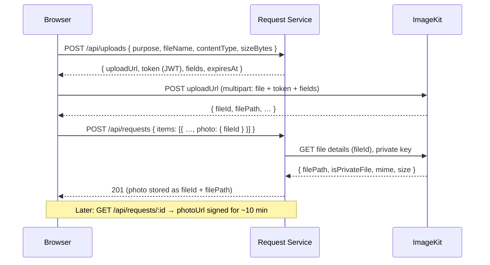

# EcoCollect: Final system communication contracts (Nov 9)

What goes in and out of every component. No SQL schema: tables are named only to say who owns what. Section 0 says what changed since Oct 28.

## Conventions

- All REST traffic goes through the gateway at `/api/*`. Bodies are JSON.
- Errors: `{ "error": { "code": "snake_case_code", "message": "Readable text", "details": { … } } }`. The `code` is the contract; the `message` can change. Validation errors put one entry per field in `details.fields`, e.g. `{ "quantity": "must be a positive integer" }`.
- Status codes mean the same thing on every endpoint:
  - `200` OK with a body, `201` created (the body is the new resource), `204` OK with no body.
  - `400` the request itself is invalid: a missing or badly formed field, or a value breaking a rule (window in the past, repeated `categoryId`, file too large). One entry per field in `details.fields`. Sending the same request again fails the same way.
  - `401` not signed in, or the token or session cookie is invalid or expired (returned by Caddy's `forward_auth`, 4.3). Sign in again.
  - `403` signed in, but not allowed: the caller lacks the role the endpoint needs (a volunteer-only account calling Q4), or can see the request but the action belongs to someone else (a volunteer viewing an Open request calls Q9).
  - `404` the resource doesn't exist, **or the caller isn't allowed to see it**. Both get the same answer (`request_unavailable` for requests), so the response never reveals that a hidden request exists (NFR03). Rule: if Q8 would return 404 for the caller, every other endpoint on that request returns 404 too, never 403.
  - `409` the request is valid, but the current state doesn't allow it (`not_open`, `already_assigned`, `window_ended`, `expired`, `terms_outdated`, …). The `code` says which state; the frontend refetches and shows the new state (16.13).
  - `500` unexpected server error. Nothing was saved (the transaction rolled back) and it's safe to retry.
- Timestamps are ISO 8601 in UTC with a `Z` suffix, stored as `timestamptz`. The frontend converts to Calgary time only for display.
- Pickup windows are a Calgary calendar date plus a start hour, with no time zone: `{ "windowId": "…", "date": "2026-11-22", "startHour": 14 }` is 14:00–15:00 Calgary time. `startHour` is an integer 0–23 (23 ends at 00:00 the next day). `windowId` is present once the window is saved.
- Time rules:
  - Convert between Calgary time and UTC only with the zone name `America/Edmonton`, never a fixed offset. Calgary was UTC−7 in January 2026 and has been UTC−6 since March 2026.
  - Windows are turned into UTC instants only in the Request Service (in code, or in SQL with `AT TIME ZONE 'America/Edmonton'`). The frontend shows windows as stored (date + hour) and never converts them.
  - The frontend formats real timestamps with `timeZone: 'America/Edmonton'` explicitly, not the device's zone.
  - "Today" and "in the future" are decided in Calgary time. Containers run in UTC, so after 18:00 in Calgary the UTC date is already tomorrow.
  - Window instants and `expiresAt` are derived when needed, never stored. The only stored copy is the Cleanup Service's job time, set from every `RequestCreated` and `RequestUpdated`.
  - Every "now" in a decision (due jobs, expiry, "in the future", "window ended", the available list) is Postgres `now()` from the same transaction, never the container clock. All services use one Postgres, so they agree on the time. `now()` is the transaction's start time, not the moment of the check.
  - A window ends 1 hour after it starts: `windowEnd = windowStart + 1 h`, computed on the UTC instant (a window with `startHour` 23 ends at 00:00 the next day). "The selected window has ended" means `now() ≥ selectedWindowEnd`. Q10, Q12, Q14, `allowedActions` and `refreshAt` all use this one check, so at the exact end, cancelling is already refused and reporting a missed pickup is already allowed.
  - Keep time zone data current: recent Node, Postgres and browser versions. Keep one test per side with known dates before and after March 2026.
- Decimals (`estimatedWeightKg`, `points`) are JSON numbers with at most 2 decimals. `node-postgres` returns `numeric` as a string: convert it before sending, and do points arithmetic in hundredths (integers) to avoid float errors.
- `accountId` is the username and is also used as the Firebase uid. Our rule: 3–50 characters, `a-z 0-9 _ -`, stored lowercase, never changes.
- Postal codes are 6 characters, uppercase, no space (`T2P1J9`), Calgary only. The frontend uppercases and removes spaces before sending; services accept only that form and return `400` for anything else (e.g. `t2p 1j9`).
- Roles live in Firebase custom claims: `{ roles: ["resident"] | ["volunteer"] | ["resident","volunteer"] }`. The active role is chosen in the frontend only; services authorize by the roles claim plus ownership of the resource.
- Assignment statuses: `Active` (accepted, not collected) → `Collected` (items picked up, not delivered) → one final status: `Delivered`, `Volunteer_Cancelled`, `Resident_Cancelled` or `Missed_Pickup` (`Ended_At` set). "Active assignment" means status `Active` only. An **unfinished** assignment is `Active` or `Collected` (`Ended_At` is null): the volunteer still has work to do.
- Privacy (NFR03): A street address appears only in your own profile (U6, and the U7 response) and in the request detail (Q8 and the responses of Q9–Q15), following the visibility table (5.2). Photo URLs appear only in the request detail. Neither ever appears in events, SSE messages, push payloads, notifications or lists.
- One Postgres instance, one schema per service. Every service can read every table; each table has exactly one service that writes it (section 8). Tables are normalized to 3NF; events and API responses are messages, not tables, so they can carry copied data.
- Every Request Service action on an existing request (Q9–Q15, `CleanupRequest`) runs in one transaction that starts by locking the request row (`SELECT … FOR UPDATE`), then reads its status, assignment and windows and decides. Actions on the same request therefore run one after another: two of them can't both succeed from the same starting state (for example Q10 by the resident and Q12 by the volunteer at the same moment), and `requestSeq` stays consecutive (10.2). The loser of a race gets the normal `409` for the new state.
- Caddy is the gateway and the only publicly exposed service. It serves the Next.js frontend and `/api/*` on one origin. The User Service is the only backend component that talks to Firebase. The Request Service is the only one that holds the ImageKit private key.

## 0. Changes since Oct 28

| Change | Why |
|---|---|
| Auth Service + profile management → **User Service** | Registration needs the Firebase Admin SDK (uid = username) and the account tables in one place |
| Pickup Service → **Request Service** | Owns the full request lifecycle, assignments, deliveries, photos |
| New: **Reward Service**, **Cleanup Service** | EcoPoints + all statistics; scheduled expiry + notification cleanup |
| `expiresAt` = the start of the last active window | FR07, FR20 |
| `safetyAcknowledged: true` → `termsDocumentId` | Records which terms version was accepted (FR22) |
| `category` in lists is now an object `{ categoryId, name, wasteType }` | Waste type is needed for display and stats |
| New event `RequestAssignmentMissed` (FR16), `ProfileUpdated`, `AccountDeactivated`, `NotificationCleanupRequested` | Missing flows |
| Every request event carries a full request snapshot plus `requestSeq` and `transitionId` | Consumers act on the state at the moment of the event; stale events can be detected (section 11) |
| New SSE messages and a public, no-login SSE stream | Expired/read notifications, live public profile and stats pages |
| Mark as read is in scope | Was deferred on Oct 28 |
| Missed is a terminal status; reporting a miss can reschedule as a new, linked request | Avoids reopening with past windows |
| Every service reads every table; one writer per table | 3NF: no copied data in tables |
| Item photos visible to volunteers; delivery photos private; GPS data removed in the browser and again by ImageKit before the file is stored | NFR03, FR06 user story |
| Demo mode runs as a separate copy of the real system | No duplicated business logic; real SSE and push |
| Volunteers whose assignment was cancelled or missed get 404 on the request page and see no request details; Q7 keeps their own assignment history | NFR03: no access to a request they no longer work on |
| The Notification Service runs as **one instance**; the per-instance SSE queue is removed | SSE connections live in that instance's memory, and one instance receives every event from the shared queue (13.0). Scaling out is deferred (18) |
| Queues are **quorum queues**; RabbitMQ dead-letters a message after 5 failed attempts | The broker counts attempts and dead-letters, so no service counts retries itself (9.5) |
| A resident can no longer cancel an Assigned request (Q10) or its assignment (Q12) once the selected window has ended; they confirm collection (Q13) or report a missed pickup (Q14) instead | FR11, FR16: a volunteer who didn't come can't get cancellation points |
| Request detail has `refreshAt` | `allowedActions` changes as time passes, and no event announces it |

## 1. Components and what they own

| Component | Owns (writes) | Publishes | Consumes | Public routes |
|---|---|---|---|---|
| Frontend (Next.js) | – | – | REST, SSE, push | Pages |
| Caddy | – | – | – | Everything (only public service) |
| User Service | Accounts, resident address, volunteer preferred postal codes, terms documents, registration/activation terms acceptances, its outbox; Firebase users and claims | `ProfileUpdated`, `AccountDeactivated` | – | `/api/session`, `/api/accounts`, `/api/terms`, `/api/profile*`, `/api/public/profiles/:accountId` + internal `/verify` |
| Request Service | Categories, facilities, pickup requests, windows, status changes, assignments, deliveries, photos (file id and path), request-creation and acceptance terms acceptances, its outbox and idempotency keys | All `Request*` events | `CleanupRequest` | `/api/categories`, `/api/facilities`, `/api/uploads`, `/api/requests*` |
| Reward Service | EcoPoints awards, its outbox, processed events | `PointsAwardedDelivery`, `PointsAwardedCancellation` | `RequestAssignmentDelivered`, `RequestAssignmentCancelledResident` | `/api/ecopoints`, `/api/public/stats`, `/api/public/profiles/:accountId/stats` |
| Notification Service | Notifications, push subscriptions, request progress (highest `requestSeq` seen), processed events | – | All `Request*`, `Points*`, `ProfileUpdated`, `AccountDeactivated`, `NotificationCleanupRequested` | `/api/events`, `/api/public/events`, `/api/notifications*`, `/api/push/*` |
| Cleanup Service | Expiry jobs, its outbox, processed events | `CleanupRequest`, `NotificationCleanupRequested` | `RequestCreated`, `RequestUpdated`, `RequestAssigned`, `RequestCancelled`, `RequestExpired` | none |
| RabbitMQ | – | – | – | none (internal) |
| Postgres | – | – | – | none (internal) |
| ImageKit (external) | Photo files | – | – | Direct browser uploads; signed delivery URLs |

## 2. Setup (manual, one time)

| # | From → To | Mechanism | Input | Output | Notes |
|---|---|---|---|---|---|
| 2.1 | Seed script → Postgres | SQL as an admin user | Schemas `users`, `requests`, `rewards`, `notifications`, `cleanup`; one DB user per service: full rights on its own schema, `SELECT` on all others (section 8); categories (name, waste type, standard weight), facilities and what they accept, the current terms document | Seeded rows | Registration replaces seeded profiles. Optional demo accounts are created through `POST /api/accounts` so Firebase and Postgres agree |
| 2.2 | Setup → User Service env | Firebase Admin key file | `secrets/firebase-admin.json` | Admin SDK ready | Only the User Service mounts it |
| 2.3 | Setup → Notification Service env | VAPID key pair | Private key in the Notification Service env; public key to the frontend as `NEXT_PUBLIC_VAPID_KEY` | Ready to send push | Same as Oct 28 |
| 2.4 | Setup → Request Service env | ImageKit keys and folder; demo flag | `IMAGEKIT_PRIVATE_KEY`, `IMAGEKIT_PUBLIC_KEY`, `IMAGEKIT_URL_ENDPOINT`, `IMAGEKIT_ROOT_FOLDER` (`/ecocollect`, or `/ecocollect-demo` in the demo stack), `DEMO_MODE` (`false`, or `true` in the demo stack, 17.5) | Ready to sign uploads and URLs | The frontend needs no ImageKit config. Upload folders (6.2) start with `IMAGEKIT_ROOT_FOLDER` |
| 2.5 | Setup → RabbitMQ | Each service declares what it uses on start | Exchanges, queues with their arguments, dead-letter queues, bindings (section 9) | Topology | Declarations are idempotent only if the arguments match exactly; a mismatch fails with `PRECONDITION_FAILED`. A queue's type can't be changed in place: when moving from the Oct 28 classic queues, delete the old queues once (or remove the RabbitMQ volume with `docker compose down -v`) |

## 3. Frontend ↔ Firebase Auth (client SDK)

| # | Call | Input | Output | Notes |
|---|---|---|---|---|
| 3.1 | `signInWithEmailAndPassword` | email, password | Firebase user | Login, and right after `POST /api/accounts` succeeds |
| 3.2 | `getIdTokenResult()` | – | ID token + `claims.roles` | Decide which role(s) to offer after login (FR02) |
| 3.3 | `getIdToken()` / `getIdToken(true)` | – | ID token (~1 h) | Before each API request. Force refresh (`true`) after role activation, then `POST /api/session` again and reopen the `EventSource` |
| 3.4 | `sendPasswordResetEmail` | email | – | Optional, frontend only |
| 3.5 | `signOut` | – | – | First `DELETE /api/push/subscriptions` and `DELETE /api/session`, then `signOut` |

There is no `createUserWithEmailAndPassword` in the frontend: it would give the user a random uid.

## 4. Caddy gateway

| # | Item | Rule |
|---|---|---|
| 4.1 | Strip client headers | Delete incoming `X-User-*` and `X-Request-Id` before anything else (already done) |
| 4.2 | Request id | `X-Request-Id` from `{http.request.uuid}`; services put it in logs and in events as `traceId` |
| 4.3 | `forward_auth` | `GET /verify` on the User Service with the original `Authorization` and `Cookie`. `200` + `X-User-Id`, `X-User-Roles` → copied onto the request. Any other status goes back to the browser as is |
| 4.4 | Routes **without** `forward_auth` | `/api/session` → User · `POST /api/accounts` → User · `GET /api/terms` → User · `/api/public/profiles/*/stats` → Reward · `/api/public/profiles/*` → User · `/api/public/stats` → Reward · `/api/public/events` → Notification. Order matters: `/api/public/profiles/*/stats` must be matched before `/api/public/profiles/*`, which would otherwise catch it. |
| 4.5 | Routes **with** `forward_auth` | `/api/profile`, `/api/profile/*` → User · `/api/categories`, `/api/facilities`, `/api/uploads`, `/api/requests`, `/api/requests/*` → Request · `/api/ecopoints` → Reward · `/api/events`, `/api/notifications`, `/api/notifications/*`, `/api/push/*` → Notification |
| 4.6 | Everything else under `/api/*` | `404` JSON. `/verify` is never routed publicly |
| 4.7 | SSE routes | `/api/events` and `/api/public/events` stream immediately; keep both out of any `encode` rule. Heartbeat every ~25 s |
| 4.8 | Trust | Only Caddy is exposed. Services trust `X-User-*` without re-verifying. Public route handlers never read `X-User-*` |
| 4.9 | Rate limit (optional) | Limit `POST /api/accounts` and `/api/public/events` connections per IP if time allows |

## 5. Public API

### 5.1 User Service

| # | Method + path | Auth | Request | Success response | Errors | Notes |
|---|---|---|---|---|---|---|
| U1 | `POST /api/session` | none (ID token in body)| `{ idToken }` | `204`, `Set-Cookie: session=…; HttpOnly; Secure; SameSite=Lax` | 400, 401, 500 | Same as Oct 28. Exists only for SSE |
| U2 | `DELETE /api/session` | Cookie | – | `204`, cookie cleared | – | |
| U3 | `GET /verify` (internal) | Bearer or cookie | – | `200` + `X-User-Id`, `X-User-Roles` | 401, 500 | Bearer first, else cookie. Both checks reject disabled (deactivated) users |
| U4 | `POST /api/accounts` | none | `{ username, email, password, firstName, lastName, publicName, dateOfBirth, role: "resident"\|"volunteer", address?: { street, postalCode }, preferredPostalCodes?: [..], termsDocumentId }` | `201 { accountId, roles }` | 400 validation (age < 18, birth date in the future, non-Calgary postal code, address missing for resident, > 3 or duplicate postal codes), 409 `username_taken` / `email_taken` / `terms_outdated` | FR01. See 7.1 for the steps. Then the frontend signs in (3.1) and calls U1 |
| U5 | `GET /api/terms` | none | – | `200 { termsDocumentId, content, publishedAt }` | – | The current document. Needed before an account exists |
| U6 | `GET /api/profile` | Bearer | – | `200 { accountId, email, firstName, lastName, publicName, dateOfBirth, roles, address: { street, city: "Calgary", postalCode } \| null, preferredPostalCodes: [..], createdAt }` | 401, 404 | Own profile only. `address` is null for volunteer-only accounts |
| U7 | `PATCH /api/profile` | Bearer | Any of `{ publicName, address: { street, postalCode }, preferredPostalCodes: [..] }` | `200` full profile (as U6) | 400, 403 `role_required` (address needs resident, codes need volunteer), 409 `address_locked` | FR04: address is locked while the resident owns an Open or Assigned request (read from Request tables, section 8). `preferredPostalCodes` replaces the whole list (0–3 distinct). Publishes `ProfileUpdated` |
| U8 | `POST /api/profile/roles` | Bearer | `{ role, termsDocumentId, address?: {..}, preferredPostalCodes?: [..] }` | `200 { roles }` | 400 (address required when activating resident), 409 `role_already_active` / `terms_outdated` | FR03. Writes the role, its terms acceptance and the Firebase claims (7.3). Frontend then does 3.3. Publishes `ProfileUpdated` (`changed: ["roles"]`) |
| U9 | `DELETE /api/profile` | Bearer | – | `204`, session cookie cleared | 409 `active_work` (owns an Open/Assigned/Collected request, or has an unfinished (Active or Collected) assignment) | Deactivation (FR04). See 7.4. Publishes `AccountDeactivated`. Frontend then signs out |
| U10 | `GET /api/public/profiles/:accountId` | none | – | `200 { accountId, publicName, roles, memberSince }` | 404 (unknown or deactivated) | FR05. EcoPoints come from R3 |

### 5.2 Request Service

| # | Method + path | Auth | Request | Success response | Errors | Notes |
|---|---|---|---|---|---|---|
| Q1 | `GET /api/categories` | Bearer | – | `200 [{ categoryId, name, wasteType, standardWeightKg }]` | 401 | |
| Q2 | `GET /api/facilities?categoryId=` | Bearer, volunteer | `categoryId` optional | `200 [{ facilityId, name, street, postalCode, specialInstructions, acceptedCategoryIds }]` | 401, 403 | With `categoryId`: only facilities that accept it (FR17) |
| Q3 | `POST /api/uploads` | Bearer | `{ purpose: "item_photo"\|"delivery_evidence", requestId?, fileName, contentType, sizeBytes }` | `200 { uploadUrl, token, fields: { fileName, folder, isPrivateFile, useUniqueFileName, overwriteFile, checks, transformation }, expiresAt }` | 400 (type not jpeg/png/webp, > 10 MB), 403 (evidence: not the assigned volunteer of a Collected request), 404 | Section 6. `requestId` is required for `delivery_evidence`. `fields` holds exactly the values pinned in the token (6.2), with `transformation` as the JSON string to send (`{"pre":"md-false"}`); the browser sends them unchanged (6.3) |
| Q4 | `POST /api/requests` | Bearer, resident | `{ items: [{ categoryId, quantity, photo?: { fileId } }], windows: [{ date, startHour }], notes?, termsDocumentId }` | `201 { requests: [{ requestId, category, quantity, estimatedWeightKg, status: "Open", createdAt, expiresAt }] }` | 400 (including a repeated `categoryId`), 403, 409 `terms_outdated` | FR06–FR08. One request per item, one transaction, one shared terms acceptance (FR22). Each `categoryId` appears at most once in `items` (FR06: one request per selected category); a repeat returns 400 with `details.fields`, e.g. `{ "items[1].categoryId": "already selected" }`. Address copied from the profile (FR07). Windows: 1–3, distinct slots, each starts in the future and ends by `createdAt + 30 days`. Optional `Idempotency-Key` header: a repeat with the same key within 24 h returns the first `201` (NFR06); keys are stored per resident in an operational table (section 8). Publishes one `RequestCreated` per request |
| Q5 | `GET /api/requests?view=mine&status=` | Bearer, resident | `status` optional, comma-separated: `Open, Assigned, Collected, Delivered, Cancelled, Expired, Missed` | `200 [{ requestId, category, quantity, estimatedWeightKg, status, createdAt, expiresAt, hasPhoto }]` newest first | 400, 401, 403 | FR09 |
| Q6 | `GET /api/requests?view=available&postalCodes=` | Bearer, volunteer | `postalCodes` optional, max 10 | `200 [{ requestId, category, quantity, estimatedWeightKg, postalCode, windows, expiresAt, hasPhoto }]` | 400, 401, 403 | FR12. Available = Open AND `expiresAt` > now; only future windows are listed. Includes the caller's own requests (FR13). The photo itself is in Q8 |
| Q7 | `GET /api/requests?view=volunteer&assignmentStatus=` | Bearer, volunteer | `assignmentStatus` optional, comma-separated: `Active, Collected, Delivered, Volunteer_Cancelled, Resident_Cancelled, Missed_Pickup` | `200 [{ requestId, category, quantity, estimatedWeightKg, postalCode, status, assignment: { assignmentId, window, status, acceptedAt, collectedAt, endedAt, endReason } }]` | 400, 401, 403 | FR21. FR21's Assigned, Collected and Delivered requests are the `Active`, `Collected` and `Delivered` assignment statuses; the other three are extra history. One row per assignment of the caller, including cancelled and missed ones: this is the volunteer's history. For an assignment that ended as `Volunteer_Cancelled`, `Resident_Cancelled` or `Missed_Pickup`, only `requestId` and `assignment` are filled; `category`, `quantity`, `estimatedWeightKg`, `postalCode` and `status` are null, because the volunteer is no longer linked to the request (Q8). Points per request come from R1 |
| Q8 | `GET /api/requests/:id` | Bearer | – | `200` request detail (below) | 401, 404 `request_unavailable` | What the caller sees depends on how they relate to the request (table below). Once a request leaves Open, only the owner, the assigned volunteer (until the assignment ends) and the delivering volunteer can open it. Anyone else, including a volunteer whose assignment was cancelled or reported missed, gets `404 request_unavailable`: the page says the request is gone (graceful handling of old push notifications) |
| Q9 | `PATCH /api/requests/:id` | Bearer, owner | Any of `{ categoryId, quantity, notes, windows, photo: { fileId } \| null }` | `200` request detail | 400, 403, 409 `not_open` / `expired` | FR10. Weight recalculated. New `windows` follow the Q4 window rules, checked against the original `createdAt` (FR07), and replace the active ones (old ones kept inactive for assignment history); `expiresAt` recalculated (12.2). Replacing or removing the photo follows 6.7. On success, publishes `RequestUpdated` (`reason: "edited"`). An overdue Open request is expired instead of edited: only `RequestExpired` (`trigger: "overdue_on_action"`) is published, and the call returns `409 expired` (12.6) |
| Q10 | `POST /api/requests/:id/cancel` | Bearer, owner | `{ reason? }` | `200` request detail | 403, 409 `not_cancellable` (not Open or Assigned) / `window_ended` (Assigned and the selected window has ended) / `expired` (overdue Open request, 12.6) | FR11. On success: if Assigned, publishes `RequestAssignmentCancelledResident` then `RequestCancelled` (one transaction); otherwise `RequestCancelled`. An overdue Open request is expired instead of cancelled: only `RequestExpired` (`trigger: "overdue_on_action"`) is published, and the call returns `409 expired` (12.6). Once the selected window has ended, the resident reports a missed pickup (Q14) instead (12.4) |
| Q11 | `POST /api/requests/:id/assignment` | Bearer, volunteer | `{ windowId, termsDocumentId }` | `201` request detail (now with address) | 400 (window not one of this request's active future windows), 409 `not_open` / `already_assigned` / `expired` / `terms_outdated` | FR13, FR22. Row lock on the request (Conventions), backed by the one-unfinished-assignment index (12.7, NFR06). A window is future while `now() < window start` (database clock), the same comparison as expiry (12.2). On success, publishes `RequestAssigned`. An overdue Open request is expired instead of accepted: only `RequestExpired` (`trigger: "overdue_on_action"`) is published, and the call returns `409 expired` (12.6) |
| Q12 | `POST /api/requests/:id/assignment/cancel` | Bearer, owner or assigned volunteer | `{ as?: "resident"\|"volunteer", reason?, windows?: [..] }` | `200` request detail | 400, 403, 409 `no_active_assignment` / `already_collected` / `window_ended` (resident only, selected window has ended) | FR11 (resident), FR14 (volunteer). `as` is required only when the caller is both owner and assigned volunteer. A resident (including `as: "resident"`) can cancel only until the selected window ends (12.4); after that, Q14. A volunteer can cancel any time before collection. `windows` (resident only) follow the Q4 window rules, checked against the original `createdAt` (FR07), and replace the active windows before reopening (12.2). Publishes `RequestAssignmentCancelledResident` or `…Volunteer`, then `RequestUpdated` (reopened) or `RequestExpired` (12.3) |
| Q13 | `POST /api/requests/:id/assignment/collected` | Bearer, owner | – | `200` request detail | 403, 409 `not_assigned` | FR15. Publishes `RequestAssignmentCollected` |
| Q14 | `POST /api/requests/:id/assignment/missed` | Bearer, owner | `{ reason?, reschedule?: { windows: [..], termsDocumentId } }` | `200 { request: <detail of the missed request>, rescheduledRequest: { requestId, category, quantity, estimatedWeightKg, status: "Open", createdAt, expiresAt } \| null }` | 400 (windows), 403, 409 `not_assigned` / `window_not_ended` / `terms_outdated` | FR16. Allowed after the selected window ends. The request becomes **Missed** (terminal). With `reschedule`, the same transaction creates a new Open request linked to the missed one (12.5). Publishes `RequestAssignmentMissed`, then `RequestCreated` for the new request if rescheduled |
| Q15 | `POST /api/requests/:id/assignment/delivery` | Bearer, assigned volunteer | `{ facilityId, evidencePhoto: { fileId } }` | `200` request detail | 400 (facility does not accept the category, FR17; photo check failed), 403, 409 `not_collected` / `already_delivered` | FR17, NFR03. Sets `Ended_At`, `End_Reason = Delivered`. Publishes `RequestAssignmentDelivered` |

Request detail (Q8 and the responses of Q9–Q15):

```json
{
  "requestId": "6c0f…", "status": "Assigned",
  "category": { "categoryId": "laptops", "name": "Computers/Laptops", "wasteType": "Electronics" },
  "quantity": 2, "estimatedWeightKg": 5.0, "postalCode": "T2P1J9",
  "windows": [{ "windowId": "w_1", "date": "2026-11-22", "startHour": 14 }],
  "createdAt": "2026-11-20T16:15:00Z", "expiresAt": "2026-11-22T20:00:00Z",
  "notes": "Side door", "address": { "street": "123 4 Ave SW", "postalCode": "T2P1J9" },
  "photoUrl": "https://ik.imagekit.io/…?ik-t=…&ik-s=…",
  "resident": { "accountId": "jasdeep", "publicName": "Jas" },
  "assignment": { "assignmentId": "a_9", "volunteer": { "accountId": "danny", "publicName": "Danny" },
                  "window": { "windowId": "w_1", "date": "2026-11-22", "startHour": 14 },
                  "status": "Active", "acceptedAt": "…", "collectedAt": null, "endedAt": null, "endReason": null,
                  "outsideCancellationWindow": false },
  "delivery": null,
  "rescheduledFrom": null, "rescheduledAs": null,
  "statusHistory": [{ "status": "Open", "changedAt": "…", "reason": null }, { "status": "Assigned", "changedAt": "…", "reason": null }],
  "viewer": "owner",
  "allowedActions": ["cancel", "cancel_assignment", "confirm_collected"],
  "refreshAt": "2026-11-21T20:00:00Z"
}
```

| Field | Owner | Volunteer with active (or delivering) assignment | Volunteer, request Open |
|---|---|---|---|
| Core fields, windows, `expiresAt` | ✓ | ✓ | ✓ (future windows only) |
| `notes`, `address` | ✓ | ✓ while assignment is Active | – |
| `photoUrl` (item photo, signed, ~10 min) | ✓ | ✓ | ✓ |
| `delivery.evidencePhotoUrl` | ✓ | ✓ (the delivering volunteer) | – |
| `resident.publicName` | ✓ | ✓ | – |
| `assignment` | current/last | their own | – |
| `rescheduledFrom`, `rescheduledAs` (`{ requestId }` or null) | ✓ | – | – |
| `statusHistory` | ✓ | – | – |

"Volunteer, request Open" means any volunteer while the request is Open. A caller who is neither the owner nor a volunteer (a resident-only account) gets `404 request_unavailable` for any other resident's request, in every status (NFR03: item photos are for the owner and volunteers). Once the request leaves Open, only the owner, the assigned volunteer (until the assignment ends) and the delivering volunteer can see it. A volunteer whose assignment was cancelled or reported missed gets `404 request_unavailable`; their history shows only their own assignment (Q7).

`viewer` names the column the response follows: `owner`, `assigned_volunteer` (active, collecting or delivering volunteer) or `volunteer` (any volunteer, request Open). A caller who is both the owner and the assigned volunteer gets `owner`, and `allowedActions` includes the actions of both sides.

`allowedActions` is computed by the server from status, role and timing (`edit`, `cancel`, `cancel_assignment`, `confirm_collected`, `report_missed`, `accept`, `record_delivery`), so the frontend never re-implements the rules. The server still checks every action. An overdue Open request (12.6) gets an empty list. For the owner of an Assigned request, the end of the selected window splits the actions: before it, `cancel`, `cancel_assignment`, `confirm_collected`; from it on, `confirm_collected`, `report_missed`. The assigned volunteer keeps `cancel_assignment` until collection.

`refreshAt` is the next moment the server would build a different response from the same stored data, or null if there is none. Time passing changes no stored state, so no event announces these moments (16.12). Assigned: the earlier future one of `selectedWindowStart − 24 h` (`assignment.outsideCancellationWindow` turns true) and `selectedWindowEnd` (`cancel_assignment` gives way to `report_missed`). Open: the start of the next active window (volunteers stop seeing it; the last one is `expiresAt`). Other statuses: null.

### 5.3 Reward Service

| # | Method + path | Auth | Request | Success response | Errors | Notes |
|---|---|---|---|---|---|---|
| R1 | `GET /api/ecopoints` | Bearer | – | `200 { total, asResident, asVolunteer, awards: [{ awardId, kind: "DELIVERY"\|"CANCELLATION", earnedAs: "resident"\|"volunteer", points, formula, requestId, assignmentId, categoryName, quantity, estimatedWeightKg, awardedAt }] }` newest first | 401 | FR18. Category, quantity and weight come from the award's assignment and request; `awardedAt` is the assignment's `Ended_At`. For `CANCELLATION` awards, `categoryName`, `quantity` and `estimatedWeightKg` are null: the volunteer is no longer linked to the request |
| R2 | `GET /api/public/stats` | none | – | `200 { deliveries, itemsDelivered, estimatedWeightKgDelivered, ecopointsAwarded, byWasteType: [{ wasteType, deliveries, itemsDelivered, estimatedWeightKgDelivered }], updatedAt }` | – | FR23. Computed by joining awards with assignments, requests and categories: one volunteer delivery award = one delivery |
| R3 | `GET /api/public/profiles/:accountId/stats` | none | – | `200 { accountId, ecopoints }` | – (unknown account → zeros) | FR05. The page calls U10 first; U10's 404 hides the page |

### 5.4 Notification Service

| # | Method + path | Auth | Request | Success response | Errors | Notes |
|---|---|---|---|---|---|---|
| N1 | `GET /api/events` | Session cookie (`EventSource`, `withCredentials: true`) | – | `200 text/event-stream` (13.3) | 401 | One stream per tab. The hub stores `userId`, roles and the connection |
| N2 | `GET /api/public/events?profile=<accountId>` or `?stats` | none | exactly one of the two | `200 text/event-stream` (13.5) | 400 | Public pages only. No user data on the stream |
| N3 | `GET /api/notifications?before=&limit=` | Bearer | `before` (ISO time), `limit` (default 30, max 100) | `200 { unreadCount, notifications: [{ notificationId, type, requestId, awardId, title, body, url, isRead, createdAt }] }` newest first | 401 | Expired notifications are never returned |
| N4 | `PATCH /api/notifications/:id/read` | Bearer | – | `204` | 401, 404 | Sends `notification-read` to the user's other connections |
| N5 | `POST /api/notifications/read-all` | Bearer | – | `204` | 401 | One `notification-read` message with `all: true` |
| N6 | `POST /api/push/subscriptions` | Bearer | `{ endpoint, keys: { p256dh, auth }, expirationTime? }` | `201` | 400, 401 | User agent from the `User-Agent` header. Same endpoint again = update (`Updated_At`) |
| N7 | `DELETE /api/push/subscriptions` | Bearer | `{ endpoint }` | `204` | 401 | On logout |

## 6. Photo uploads (ImageKit, browser uploads directly)

The browser uploads straight to ImageKit; our server only signs the upload and checks the result. ImageKit's V2 client-side upload uses a one-time JWT that the server signs with the private key. The JWT carries the upload parameters, so the browser cannot change the folder, the file name, `isPrivateFile` or the pre-transformation that strips metadata (6.2). V2 is marked beta, so confirm the exact JWT claims and form fields (including `transformation`) against ImageKit's V2 docs when implementing. If you fall back to V1 (`token` + `expire` + `signature`), the parameters are not pinned: step 6.5 still catches a wrong folder, privacy flag, type or size, but not a missing pre-transformation, so the browser step (6.0) is then the only metadata stripping.



| # | Step | Contract |
|---|---|---|
| 6.0 | Prepare in the browser | Before asking for a token, draw the image on a canvas and re-encode it (JPEG or WebP, longest side ≤ 2048 px). This removes EXIF data, including the GPS location phone photos carry, before the file leaves the device, and shrinks the file. ImageKit strips all metadata again before storing the file (6.2), so a client that skips this step still leaks nothing (NFR03). The upload field says: no house numbers, faces, mail or documents in the photo |
| 6.1 | `POST /api/uploads` (Q3) | Server checks role and purpose (evidence: caller is the assigned volunteer of a Collected request), type in `image/jpeg, image/png, image/webp`, size ≤ 10 MB |
| 6.2 | JWT pins | `fileName: "<uuid>.<ext>"`, `folder`: `<IMAGEKIT_ROOT_FOLDER>/item-photos/<callerAccountId>/` or, for evidence, `<IMAGEKIT_ROOT_FOLDER>/delivery-evidence/<callerAccountId>/<requestId>/` (2.4), `isPrivateFile: true`, `useUniqueFileName: false`, `overwriteFile: false`, `transformation: { pre: "md-false" }` (ImageKit strips all metadata, including GPS, before storing the file), plus a `checks` expression limiting size and MIME type. Expires in 10 min, one use |
| 6.3 | Browser upload | `POST https://upload.imagekit.io/api/v2/files/upload`, multipart, with the file, the token, and every entry of Q3's `fields` sent unchanged. The browser adds or changes nothing: any difference from the token fails with "invalid payload". One file per call |
| 6.4 | Attach | The browser sends only `{ fileId }` (Q4 items, Q9, Q15) |
| 6.5 | Verify | Request Service fetches the file details with the private key and rejects (400 `invalid_photo`) unless: `filePath` starts with the folder 6.2 pins for this caller and purpose, `isPrivateFile` is true, MIME and size are allowed. It stores `fileId` and `filePath` as one PHOTO row and links it from the request (item photo) or the delivery (evidence) |
| 6.6 | Read | Q8 builds a signed URL with the ImageKit SDK (`signed: true`, ~600 s) only for the people in the visibility table (5.2). The URL is never stored or put in events |
| 6.7 | Replace/remove | Q9 with a new photo or `null` detaches the old file from that request. After commit, the Request Service deletes the file from ImageKit **only if no other request still references it** (a rescheduled request shares its photo with the missed one, 12.5). Deletion is best effort and logged on failure. Files are never deleted because a request reaches a final status: they are part of its history. Evidence photos are never shared (6.5) or deleted |
| 6.8 | Orphans | Files uploaded but never attached stay in ImageKit. Cleaning them up is deferred (section 18) |

## 7. User Service ↔ Firebase Auth (Admin SDK)

| # | Flow | Steps | Failure handling |
|---|---|---|---|
| 7.1 | Registration (U4) | Validate → `createUser({ uid: username, email, password, displayName: publicName })` → `setCustomUserClaims(uid, { roles: [role] })` → one DB transaction: account, role row, address or postal codes, terms acceptance | `auth/uid-already-exists` or `auth/email-already-exists`: look up that Firebase user (`getUser(uid)` / `getUserByEmail(email)`). If no ACCOUNT row has its uid and it was created more than 10 minutes ago (`metadata.creationTime`), it is left over from a crash: `deleteUser` it and register again once. Otherwise 409 `username_taken` / `email_taken`. If the DB transaction fails, `deleteUser(uid)` and return 500 |
| 7.2 | Verify (U3) | `verifyIdToken(token, true)` or `verifySessionCookie(cookie, true)` → `{ uid, roles }` | 401. The `true` also rejects disabled users and revoked tokens |
| 7.3 | Role activation (U8) | DB transaction (role row, terms acceptance, outbox) → `setCustomUserClaims(uid, { roles: [...old, role] })` | If the claims call fails, retry 3 times; if it still fails, reverse the DB change in a new transaction and return 500 |
| 7.4 | Deactivation (U9) | Check active work (section 8) → `updateUser(uid, { disabled: true })` + `revokeRefreshTokens(uid)` → DB transaction: `Deactivated_At`, outbox `AccountDeactivated` | If the DB transaction fails, `updateUser(uid, { disabled: false })` and return 500 |
| 7.5 | Session (U1) | `createSessionCookie(idToken, { expiresIn: 5 days })` | 401 if the sign-in is not recent |

## 8. Who writes and who reads

Each service's DB user has full rights on its own schema and `SELECT` on every other schema. Reading is free; writing has one owner per table, so each rule (and its locking and outbox event) lives in one place.

| Writer | Tables (ER names) |
|---|---|
| User Service | ACCOUNT, RESIDENT, VOLUNTEER, preferred postal codes, TERMS_DOCUMENT |
| Request Service | ITEM_CATEGORY, RECYCLING_FACILITY, facility–category link, PICKUP_REQUEST, PICKUP_WINDOW, PHOTO, STATUS_CHANGE, ASSIGNMENT, DELIVERY |
| Reward Service | ECOPOINTS_AWARD |
| Notification Service | NOTIFICATION, PUSH_SUBSCRIPTION |
| User **and** Request Service | TERMS_ACCEPTANCE: the one exception. It is insert-only; the User Service inserts registration and activation acceptances, the Request Service inserts request-creation and volunteer-acceptance ones. Neither updates or deletes rows |
| Each service | Its own operational tables, outside the ER model: outbox (producers), processed events (consumers), Cleanup's expiry jobs, Notification's request progress, Request's idempotency keys (Q4) |

Main reads across services:

| Reader | Reads | For |
|---|---|---|
| Request Service | Resident address, preferred postal codes, `Deactivated_At`, current terms document | Copying the address (FR07), matching volunteers (skipping deactivated ones), terms checks |
| User Service | Requests owned by the account and their status; the account's unfinished (Active or Collected) assignments | Address lock (FR04), deactivation guard (U9) |
| Reward Service | Assignments, requests, categories | Award lists and statistics (R1–R3) |
| Notification Service | Requests, categories, assignments, awards, accounts (public name, `Deactivated_At`) | Building titles and bodies; skipping deactivated recipients |


These reads are the only dependencies between services. A change to a table or column listed here must be agreed with the service that reads it; everything else in a service's schema can change freely (NFR01). Sharing one database this way is a deliberate tradeoff: it keeps the data in 3NF with no copies, at the cost of this short list of shared columns.

Reads show the current state. For a decision that depends on another service's data at the moment something happened, use the facts in the event (section 11).

Known race, accepted: a resident could create a request at the same instant as changing their address. The window is milliseconds. Closing it fully would need a lock across schemas, which needs write rights we don't want to grant.

Idempotency keys (Q4): the Request Service's table holds `(Resident_ID, Idempotency_Key)` as primary key, the stored `201` body and `created_at`. Q4 inserts the key first, in the same transaction as the requests. A second call with the same key waits on the primary key until the first commits, then hits the conflict and returns the stored body. A key older than 24 h is overwritten.

## 9. RabbitMQ

| # | Item | Value |
|---|---|---|
| 9.1 | Exchanges | `ecocollect.events`, `topic`, durable. `ecocollect.dlx`, `direct`, durable (dead letters only) |
| 9.2 | Message properties | `messageId = eventId`, `type = <event type>`, `contentType = application/json`, persistent |
| 9.3 | Publishing | Every producer writes the event to its own outbox table in the same transaction as the change. A publisher loop in the same process sends unpublished rows in order (`created_at`, then insertion order), with publisher confirms; `published_at` is set only after the confirmation |
| 9.4 | Consuming | Manual ack after the DB work commits. Each consumer records `eventId` in its own processed-events table in the same transaction and skips duplicates. `prefetch = 1` per consumer keeps events for the same request in order in the normal case. Never use global QoS: quorum queues refuse it |
| 9.5 | Processing fails | Roll back, then `basic.reject` with `requeue = true`. Use `reject`, **not** `basic.nack`: in RabbitMQ 4.x only `reject` (or a lost connection) adds to the message's delivery count; `nack` doesn't. RabbitMQ moves the message to `<queue>.dlq` once it has failed 5 times (`x-delivery-limit = 4`, below). No service counts attempts itself. A redelivered event can arrive after newer ones; section 11 covers that |
| 9.6 | Unusable message | Invalid JSON, unknown `type`, or an envelope that fails validation: `basic.reject` with `requeue = false`. It goes straight to the DLQ, since retrying can't fix it |
| 9.7 | Logging | Before every reject, log `eventId`, `type`, queue, the error and the `x-delivery-count` header (absent on the first attempt). A failure with `x-delivery-count = 4`, or a 9.6 reject, is logged as an error: the message is being dead-lettered |

| Queue (quorum) | Bindings on `ecocollect.events` | Consumer |
|---|---|---|
| `notification.events` | `request.#`, `reward.#`, `user.#`, `cleanup.notifications.due` | Notification Service |
| `cleanup.request-events` | `request.created`, `request.updated`, `request.assigned`, `request.cancelled`, `request.expired` | Cleanup Service |
| `reward.request-events` | `request.assignment.delivered`, `request.assignment.cancelled.resident` | Reward Service |
| `request.cleanup-events` | `cleanup.request.due` | Request Service |

Arguments on each queue above (declared by its consumer, exactly as written):

| Argument | Value |
|---|---|
| `x-queue-type` | `quorum` |
| `x-delivery-limit` | `4` (dead-lettered on the 5th failure; RabbitMQ's default would be 20) |
| `x-dead-letter-exchange` | `ecocollect.dlx` |
| `x-dead-letter-routing-key` | the queue's own name, e.g. `reward.request-events` |

Dead-letter queues: the same consumer also declares `<queue>.dlq` (`x-queue-type = quorum`, no other arguments) and binds it to `ecocollect.dlx` with routing key `<queue>`.

## 10. Events

### 10.1 Envelope (every event)

```json
{
  "eventId": "uuid",
  "type": "RequestCreated",
  "version": 2,
  "occurredAt": "2026-11-20T16:15:00Z",
  "producer": "request-service",
  "traceId": "<X-Request-Id of the HTTP call that caused it, or null>",
  "data": { }
}
```

`version` is per event type: `RequestCreated` is 2 (its payload changed since Oct 28), all others start at 1. Consumers ignore unknown fields.

### 10.2 Request snapshot (in every `Request*` event as `data.request`)

The state of the request **after** the change:

`requestId, requestSeq, transitionId, status, residentUid, categoryId, categoryName, wasteType, quantity, estimatedWeightKg, postalCode, windows: [{ windowId, date, startHour }] (active only), createdAt, expiresAt`

- `requestSeq`: a per-request counter stored on the request row, +1 for every event about that request, incremented under the row lock in the same transaction that writes the outbox rows. Two events from one action get consecutive numbers.
- `transitionId`: one uuid per action (per transaction). Events from the same action share it.

Assignment snapshot (as `data.assignment` where noted): `assignmentId, volunteerUid, window: { windowId, date, startHour }, acceptedAt, collectedAt, endedAt, endReason`.

### 10.3 Event list

| # | Event | Routing key | Producer: trigger | `data` besides `request` | Consumers |
|---|---|---|---|---|---|
| E1 | `RequestCreated` | `request.created` | Request: Q4, one per created request; Q14 with `reschedule` | `matchedVolunteerUids`, `rescheduledFromRequestId` (null unless rescheduled) | Notification, Cleanup |
| E2 | `RequestUpdated` | `request.updated` | Request: Q9 edit, or reopen after Q12 | `reason: "edited"\|"reopened"`, `changed: ["category","quantity","notes","windows","photo"]` (edited only), `matchedVolunteerUids` | Notification, Cleanup |
| E3 | `RequestAssigned` | `request.assigned` | Request: Q11 | `assignment` | Notification, Cleanup |
| E4 | `RequestAssignmentCollected` | `request.assignment.collected` | Request: Q13 | `assignment` | Notification |
| E5 | `RequestAssignmentDelivered` | `request.assignment.delivered` | Request: Q15 | `assignment`, `facility: { facilityId, name }`, `deliveredAt` | Notification, Reward |
| E6 | `RequestAssignmentCancelledResident` | `request.assignment.cancelled.resident` | Request: Q12 by owner, or Q10 on an Assigned request, both only before the selected window ends (12.4) | `assignment`, `cancelledAt`, `outsideCancellationWindow` | Notification, Reward |
| E7 | `RequestAssignmentCancelledVolunteer` | `request.assignment.cancelled.volunteer` | Request: Q12 by volunteer | `assignment`, `cancelledAt` | Notification |
| E8 | `RequestAssignmentMissed` | `request.assignment.missed` | Request: Q14 (request status in the snapshot is `Missed`) | `assignment`, `reportedAt`, `rescheduledAsRequestId` (null if not rescheduled) | Notification |
| E9 | `RequestCancelled` | `request.cancelled` | Request: Q10 | `reason` | Notification, Cleanup |
| E10 | `RequestExpired` | `request.expired` | Request: `CleanupRequest` confirmed, an assignment cancellation (Q12) when `now() ≥ expiresAt`, or Q9/Q10/Q11 on an overdue Open request (12.6) | `trigger: "cleanup_job"\|"assignment_cancelled"\|"overdue_on_action"` | Notification, Cleanup |
| E11 | `PointsAwardedDelivery` | `reward.points.delivery` | Reward: after E5 | `requestId, assignmentId, categoryName, quantity, estimatedWeightKg, awards: [{ awardId, accountId, earnedAs, points, formula }]` (2 awards) | Notification |
| E12 | `PointsAwardedCancellation` | `reward.points.cancellation` | Reward: after E6 with `outsideCancellationWindow: true` | Same shape, 1 award (volunteer) | Notification |
| E13 | `CleanupRequest` | `cleanup.request.due` | Cleanup: a pending job is due (at `expiresAt`, then every 5 min until E3, E9 or E10 ends it) | `requestId, requestSeq, expiresAt` | Request |
| E14 | `NotificationCleanupRequested` | `cleanup.notifications.due` | Cleanup: daily at 03:00 Calgary | `requestedAt` | Notification |
| E15 | `ProfileUpdated` | `user.profile.updated` | User: U7, U8 | `accountId, changed: ["publicName","address","preferredPostalCodes","roles"], publicName, roles` (never the address itself) | Notification |
| E16 | `AccountDeactivated` | `user.account.deactivated` | User: U9 | `accountId, deactivatedAt` | Notification |

`matchedVolunteerUids` (E1, E2): every volunteer whose preferred postal codes include the request's postal code (exact, full 6-character match, on purpose: notifications go only to volunteers who chose that exact code; the available list (Q6) can always be browsed without the filter, 16.9), leaving out deactivated accounts and the request's own resident (in demo mode the resident stays in, 17.5). The Request Service computes it in the same transaction (section 8).

Events from one action, in order: Q10 on Assigned → E6, E9. Q12 → E6 or E7, then E2 (reopened) or E10. Q14 → E8, then E1 for the new request if rescheduled (the new request has its own `requestSeq` starting at 1; both events share the `transitionId`).

Events keep carrying copies of request data (snapshots). That is fine for 3NF, which applies to tables only, and it lets consumers act on the state at the moment of the event.

### 10.4 Examples

`RequestCreated` (v2):

```json
{
  "eventId": "0b9e5a2c-…", "type": "RequestCreated", "version": 2,
  "occurredAt": "2026-11-20T16:15:00Z", "producer": "request-service", "traceId": "4f1d…",
  "data": {
    "request": {
      "requestId": "6c0f…", "requestSeq": 1, "transitionId": "a71e…", "status": "Open",
      "residentUid": "jasdeep", "categoryId": "laptops", "categoryName": "Computers/Laptops",
      "wasteType": "Electronics", "quantity": 2, "estimatedWeightKg": 5.0, "postalCode": "T2P1J9",
      "windows": [{ "windowId": "w_1", "date": "2026-11-22", "startHour": 14 }],
      "createdAt": "2026-11-20T16:15:00Z", "expiresAt": "2026-11-22T20:00:00Z"
    },
    "matchedVolunteerUids": ["danny", "vedant"]
  }
}
```

`expiresAt` here is the start of the only window (14:00 Calgary time = 20:00Z; Calgary stays at UTC−6 all year now).

`RequestAssignmentCancelledResident` (from Q12, followed by `RequestUpdated` with `requestSeq` 4 and the same `transitionId`):

```json
{
  "eventId": "…", "type": "RequestAssignmentCancelledResident", "version": 1,
  "occurredAt": "2026-11-22T08:30:00Z", "producer": "request-service", "traceId": "…",
  "data": {
    "request": { "requestId": "6c0f…", "requestSeq": 3, "transitionId": "c3d2…", "status": "Open", "…": "…" },
    "assignment": { "assignmentId": "a_9", "volunteerUid": "danny",
                    "window": { "windowId": "w_1", "date": "2026-11-22", "startHour": 14 },
                    "acceptedAt": "2026-11-21T02:00:00Z", "collectedAt": null,
                    "endedAt": "2026-11-22T08:30:00Z", "endReason": "Resident_Cancelled" },
    "cancelledAt": "2026-11-22T08:30:00Z",
    "outsideCancellationWindow": true
  }
}
```

`outsideCancellationWindow` is true because the cancellation came less than 24 hours before the window start (20:00Z).

`PointsAwardedDelivery`:

```json
{
  "eventId": "…", "type": "PointsAwardedDelivery", "version": 1,
  "occurredAt": "2026-11-22T23:10:02Z", "producer": "reward-service", "traceId": null,
  "data": {
    "requestId": "6c0f…", "assignmentId": "a_9", "categoryName": "Computers/Laptops",
    "quantity": 2, "estimatedWeightKg": 5.0,
    "awards": [
      { "awardId": "aw_1", "accountId": "danny",   "earnedAs": "volunteer", "points": 26.0, "formula": "3 * quantity + 4 * estimatedWeightKg" },
      { "awardId": "aw_2", "accountId": "jasdeep", "earnedAs": "resident",  "points": 13.0, "formula": "(3 * quantity + 4 * estimatedWeightKg) / 2" }
    ]
  }
}
```

`CleanupRequest`:

```json
{ "eventId": "…", "type": "CleanupRequest", "version": 1, "occurredAt": "2026-11-22T20:00:05Z",
  "producer": "cleanup-service", "traceId": null,
  "data": { "requestId": "6c0f…", "requestSeq": 1, "expiresAt": "2026-11-22T20:00:00Z" } }
```

## 11. Stale events: how each consumer handles them

An event says what was true when it happened, not what is true now. It can be old by the time it is processed (queue backlog, a retry), or arrive after a newer one (redelivery). Three rules cover every case:

1. **The producer is the only source of truth for current state.** No consumer treats an event as current state for an irreversible decision without asking the owner.
2. **Facts about a moment never go stale.** "This assignment was cancelled 7 hours before its window" stays true forever. The Request Service computes such facts inside the transaction and puts them in the event.
3. **Order by `requestSeq`, not by arrival.** A consumer that keeps state per request remembers the highest `requestSeq` it has applied and treats anything lower as history.

| Consumer | Risk | Handling |
|---|---|---|
| Reward | Points computed from changed data | Inputs are facts frozen at the moment (quantity and weight come from the event, as they were at that moment; `outsideCancellationWindow` is decided by the Request Service at cancel time). At most one award per assignment per role makes retries harmless (NFR06) |
| Cleanup | An old `RequestUpdated` arrives after `RequestAssigned` and re-creates a job | Each job stores the `requestSeq` it came from. Upsert only if the incoming `requestSeq` is higher. Non-Open events leave a "no job" marker with their `requestSeq` instead of deleting the row, so an older event cannot bring the job back. A job ends only on a non-Open event, never by firing |
| Request (`CleanupRequest`) | The job fires after the request changed | Lock the request row and re-check: still Open and `now() ≥ expiresAt` → mark Expired and publish E10. Otherwise ack and do nothing. `data.requestSeq` and `expiresAt` are for logs only |
| Notification | An old event pushes a misleading alert, or expires newer notifications | Keeps the highest `requestSeq` per request. An event with a lower `requestSeq` is stored as already expired: no SSE `notification`, no push. Expiry rules (13.2) only expire notifications with a lower `requestSeq`. Recipients whose account has `Deactivated_At` set are skipped |
| Notification (matching) | `matchedVolunteerUids` is a snapshot | Accepted. A volunteer who changed preferences seconds earlier might get one notification more or less |
| Frontend | Old data on screen | SSE and push are only signals. Data always comes fresh from REST (unchanged from Oct 28). After an `EventSource` reconnect, refetch everything on screen |

## 12. Request lifecycle (rules the contracts depend on)

### 12.1 Transitions

| Action | From | To | Events |
|---|---|---|---|
| Create (Q4) | – | Open | E1 |
| Edit (Q9) | Open | Open | E2 (`edited`) |
| Accept (Q11) | Open | Assigned | E3 |
| Resident cancels assignment (Q12) | Assigned (not collected), selected window not ended | Open or Expired | E6, then E2 (`reopened`) or E10 |
| Volunteer cancels assignment (Q12) | Assigned (not collected) | Open or Expired | E7, then E2 (`reopened`) or E10 |
| Report missed (Q14) | Assigned, selected window ended | Missed (terminal) | E8; with `reschedule` also E1 for a new Open request |
| Confirm collected (Q13) | Assigned | Collected | E4 |
| Record delivery (Q15) | Collected | Delivered | E5 |
| Cancel request (Q10) | Open | Cancelled | E9 |
| Cancel request (Q10) | Assigned, selected window not ended | Cancelled | E6, E9 |
| Expire (`CleanupRequest`) | Open, `now() ≥ expiresAt` (database clock) | Expired | E10 |
| Expire on action (Q9, Q10, Q11) | Open, `now() ≥ expiresAt` (job not processed yet) | Expired | E10 (`overdue_on_action`); the call returns `409 expired` (12.6) |

Every status change adds a status change row. Statuses: Open, Assigned, Collected, Delivered, Cancelled, Expired, Missed. Final: Delivered, Cancelled, Expired, Missed.

### 12.2 `expiresAt`

`expiresAt = start of the latest active window`, where a window starts at `date + startHour`, Calgary time, converted to UTC. After that moment no window is in the future, so no one can accept the request (FR13). It is derived whenever needed, so it follows any change to the active windows (Q9, Q12 with `windows`). New windows must end by `createdAt + 30 days` (FR07), and that limit never moves (reopening after an assignment cancellation doesn't reset it, FR11). So a request can't stay Open longer than 30 days. A rescheduled request (12.5) is a new request with its own `createdAt`.

### 12.3 Reopen or expire (assignment cancellations only)

When an assignment is cancelled before collection (Q12), the request goes back to Open, but only if it can still be picked up. FR20 says an Open request expires when its last window starts. Cancellations usually happen before the window, but not always: a resident can cancel until the selected window ends (12.4), and a volunteer any time before collection. Example:

- Windows offered: Nov 22 at 14:00 and Nov 23 at 10:00. A volunteer accepts Nov 23 and cancels at 10:30 on Nov 23, after the window has started.
- Both windows have started, so `expiresAt` (start of the last window, 10:00 Nov 23) has already passed.
- An Open request with no future window can't be accepted by anyone, so instead of reopening it, the Request Service marks it Expired in the same transaction (`RequestExpired`, `trigger: "assignment_cancelled"`).

A resident cancelling the assignment can send new `windows` in Q12, which move `expiresAt` so the request reopens normally. A volunteer cancellation can't, so it may expire the request; the resident is told by `REQUEST_EXPIRED_RESIDENT` and can create a new request. Missed pickups don't reopen at all (12.5).

A volunteer can still cancel after the selected window has ended, because FR14 allows it until collection. The assignment then ends as `Volunteer_Cancelled`, not `Missed_Pickup`, and the request reopens or expires by the rule above, so the resident has no missed pickup to report and no linked reschedule (12.5). If it reopened, they can edit its windows (Q9); if it expired, they create a new request.

### 12.4 Cancellation window (FR11)

`outsideCancellationWindow = cancelledAt > selectedWindowStart − 24 h`. Decided by the Request Service at cancel time, carried in E6, never recomputed.

A resident can cancel (Q10 on an Assigned request, Q12) only while `now() < selectedWindowEnd`. Once the selected window has ended (`now() ≥ selectedWindowEnd`), both return `409 window_ended`, and the resident confirms collection (Q13) or reports a missed pickup (Q14). So when E6 carries `outsideCancellationWindow: true`, the resident cancelled between 24 h before the window start and the window end, never after it. A volunteer who didn't come is reported missed and gets no cancellation points (FR16).

### 12.5 Missed pickup and rescheduling

| # | Rule |
|---|---|
| 12.5.1 | Q14 ends the assignment (`End_Reason = Missed_Pickup`) and moves the request to **Missed**, a final status. It never reopens |
| 12.5.2 | With `reschedule`, the same transaction creates a new request: same resident, category, quantity, notes and photo; estimated weight recalculated from the current standard weight (it is a new request, FR06); address copied from the profile (unchanged, FR04 locked it); the new `windows` (validated against the new `createdAt`); a new `AT_RESIDENT_REQUEST_CREATION` terms acceptance (FR22); status Open with its own `createdAt` and `expiresAt` |
| 12.5.3 | The new request stores a reference to the missed one (`Rescheduled_From_Request_ID`, unique). A missed request can therefore be rescheduled once. The resident sees "Missed, rescheduled as …" and "Rescheduled from …" (Q8 `rescheduledFrom`, `rescheduledAs`) |
| 12.5.4 | Without `reschedule`, the request is just Missed. The resident can create a new request later as usual (not linked) |
| 12.5.5 | The photo file is shared, not copied. 6.7 keeps it as long as either request references it |

### 12.6 Overdue Open requests (FR20)

An Open request is **overdue** when `now() ≥ expiresAt` but its `CleanupRequest` hasn't been processed yet (the Cleanup poll runs every 30 s, then the event waits in the queue). By FR20 it is already expired, so no action may treat it as Open:

- Q9, Q10 and Q11 lock the row (Conventions), find the request overdue, mark it Expired (status change row, outbox `RequestExpired` with `trigger: "overdue_on_action"`), **commit**, then return `409 expired`. The resident gets `REQUEST_EXPIRED_RESIDENT` as usual.
- Q12 already makes the same check when an assignment is cancelled (12.3, `trigger: "assignment_cancelled"`).
- Q8 still shows `status: "Open"` until then, with an empty `allowedActions`. Q6 already hides it (`expiresAt > now`).
- The `CleanupRequest` that arrives later finds the request no longer Open and does nothing (section 11).

### 12.7 Database guards (NFR06)

The row lock handles the normal case. These constraints make a missed check fail instead of writing a duplicate:

| Guard | Constraint |
|---|---|
| One unfinished assignment per request | Partial unique index on ASSIGNMENT (`Request_ID`) `WHERE Ended_At IS NULL` |
| One delivery per assignment | `UNIQUE (Assignment_ID)` on DELIVERY |
| A missed request is rescheduled once | `UNIQUE (Rescheduled_From_Request_ID)` on PICKUP_REQUEST (12.5.3) |
| One stored Q4 response per idempotency key | Primary key `(Resident_ID, Idempotency_Key)` on the idempotency table (section 8) |

A violation means a bug, or a race the lock missed: roll back and return the `409` the endpoint gives for the new state.

## 13. Notification Service internals and outputs

### 13.0 One instance

The Notification Service runs as exactly one container: no `deploy.replicas`, no `docker compose --scale` (the demo stack, 17.1, also has one). That instance holds every SSE connection (`/api/events` and `/api/public/events`) in memory and is the only consumer of `notification.events`, so every event reaches the process that holds the recipient's connections. A second instance would take only some of the events from the shared queue, and users connected to it would miss live updates. A restart drops all streams; the frontend reconnects and refetches (16.5). Scaling out is deferred (18).

### 13.1 Notification types

The Push column is decided by type: the side that performed the action gets no push, the other side does. An account on both sides (self-accept, self-delivery) gets the other side's push. Tag for push: `request-<requestId>` (request types) or `award-<awardId>` (award types). The `url` opens the relevant page: the request page, except for `ASSIGNMENT_CANCELLED_BY_RESIDENT_VOLUNTEER`, `ASSIGNMENT_CANCELLED_BY_VOLUNTEER_VOLUNTEER` and `ASSIGNMENT_MISSED_VOLUNTEER`, which open the volunteer's assignment history (the recipient can no longer open the request, Q8), and award types, which open the EcoPoints page.

| Event | Type → recipient | Push |
|---|---|---|
| E1 | `REQUEST_CREATED` → resident | – |
| E1 | `NEW_MATCHING_REQUEST` → each matched volunteer | ✓ |
| E2 | `REQUEST_UPDATED_RESIDENT` → resident (metadata `reason`) | – (on reopen, the E6/E7/E8 notification carries the push) |
| E2 | `NEW_MATCHING_REQUEST` → each matched volunteer | ✓ |
| E3 | `REQUEST_ASSIGNED_RESIDENT` → resident | ✓ |
| E3 | `REQUEST_ASSIGNED_VOLUNTEER` → volunteer | – |
| E4 | `REQUEST_COLLECTED_RESIDENT` → resident | – |
| E4 | `REQUEST_COLLECTED_VOLUNTEER` → volunteer | ✓ |
| E5 | `REQUEST_DELIVERED_RESIDENT` → resident | ✓ |
| E5 | `REQUEST_DELIVERED_VOLUNTEER` → volunteer | – |
| E6 | `ASSIGNMENT_CANCELLED_BY_RESIDENT_RESIDENT` → resident | – |
| E6 | `ASSIGNMENT_CANCELLED_BY_RESIDENT_VOLUNTEER` → volunteer | ✓ |
| E7 | `ASSIGNMENT_CANCELLED_BY_VOLUNTEER_RESIDENT` → resident | ✓ |
| E7 | `ASSIGNMENT_CANCELLED_BY_VOLUNTEER_VOLUNTEER` → volunteer | – |
| E8 | `ASSIGNMENT_MISSED_RESIDENT` → resident | – |
| E8 | `ASSIGNMENT_MISSED_VOLUNTEER` → volunteer | ✓ |
| E9 | `REQUEST_CANCELLED_RESIDENT` → resident | – |
| E10 | `REQUEST_EXPIRED_RESIDENT` → resident | ✓ |
| E11 | `ECOPOINTS_AWARDED_ON_DELIVERY_RESIDENT` / `…_VOLUNTEER` → each award's account | ✓ |
| E12 | `ECOPOINTS_AWARDED_ON_ASSIGNMENT_CANCELLATION_VOLUNTEER` → volunteer | ✓ |

When one account is both sides (self-accept, self-delivery, FR13), it gets both notifications.

A notification stores its type, recipient, the request or award it is about, and metadata holding only facts not stored in any table: `requestSeq`, `transitionId`, and for E2 `reason` and `changed`. Title and body are built when read, by joining the request, category, assignment (window, volunteer's public name) or award (points). A request's details can change only while it is Open, and any change expires its older notifications (13.2), so the joined values always match what a live notification describes. It also stores when a push for it was actually sent (`Pushed_At`, null if none: the type said no push, the recipient has no subscription, or the event was stale), for 13.2. Example titles: "New pickup near you" / "2 * Computers/Laptops in T2P1J9"; "Pickup accepted" / "Danny will come on Nov 22, 14:00–15:00"; "You earned 26 EcoPoints". Notifications to a volunteer whose assignment ended without delivery (`ASSIGNMENT_CANCELLED_BY_RESIDENT_VOLUNTEER`, `ASSIGNMENT_CANCELLED_BY_VOLUNTEER_VOLUNTEER`, `ASSIGNMENT_MISSED_VOLUNTEER`, `ECOPOINTS_AWARDED_ON_ASSIGNMENT_CANCELLATION_VOLUNTEER`) show no request details, only the assignment's window and the points: "Pickup cancelled" / "Your pickup on Nov 22, 14:00–15:00 was cancelled".

SSE `notification` messages and pushes build their title and body from the event’s snapshots, not the tables (which may already be ahead of a late event); only public names are read from ACCOUNT, as current values (section 8).

### 13.2 Expiry rules (`Is_Expired`)

A notification expires when the request it describes has moved past that state. Award notifications never expire.

| Rule | When | What expires |
|---|---|---|
| X1 per recipient | A new request notification is created for account A about request R | A's older request notifications about R from **other** actions (`transitionId` differs, `requestSeq` lower). Notifications from the same action stay together: "Danny cancelled" and "Request reopened" are both kept |
| X2 matching | R leaves Open (E3, E9, E10) or is updated (E2) | Every `NEW_MATCHING_REQUEST` about R with a lower `requestSeq`, for every volunteer. On E2, the matched volunteers get fresh ones |
| X3 stale | Event with `requestSeq` lower than the highest seen for R | The new notifications are saved already expired |

Effects of an expiry:
- SSE `notification-expired` to the recipient's open connections.
- If that notification was pushed and is unread, and the recipient isn't getting a new push for R in this action, send a replacement push with the same tag and `silent: true` ("This pickup is no longer available" / the new state). Otherwise the new push replaces it by tag anyway.
- Expired notifications are deleted on `NotificationCleanupRequested` (E14).

### 13.3 SSE messages on `/api/events`

| `event:` | `data` | Sent to | Frontend action |
|---|---|---|---|
| `ready` | `{}` | The new connection only, once, as its first message | Nothing to handle: it makes `onopen` fire at once. Refetch in `onopen` (16.5) |
| `notification` (`id:` = notificationId) | `{ notificationId, type, requestId, awardId, title, body, url, createdAt }` | Every open connection of the recipient | 16.3 |
| `notification-expired` | `{ notificationIds: [..], requestId, tag }` | Recipient | Invalidate `["notifications"]`; close OS notifications with `tag` via `registration.getNotifications({ tag })` |
| `notification-read` | `{ notificationIds: [..] }` or `{ all: true }` | The user's **other** connections (one message per N4/N5 call) | Invalidate `["notifications"]`; close OS notifications for those ids |
| `profile-updated` | `{ changed: [..] }` | The user's connections (E15) | Invalidate `["profile"]`; if `roles` changed, do 3.3 |
| `available-requests-changed` | `{ requestId }` | Every connection whose roles include volunteer, on E1, E2, E3, E9, E10 | Invalidate `["requests","available"]` and `["request", requestId]` |
| `account-deactivated` | `{}` | The user's connections (E16), then the server closes them | Sign out |
| comment `: ping` | – | Everyone, every ~25 s | Ignored by `EventSource` |

`Last-Event-ID` resume is not supported: after a reconnect the frontend refetches (11). The server writes `ready` as soon as it registers a connection, so `onopen` fires right away instead of when the first `: ping` arrives (up to ~25 s later).

The `title` and `body` of a `notification` message are built from the event, not the tables; only public names are read from ACCOUNT (13.1).

### 13.4 Push

Payload (encrypted with the subscription keys):

```json
{ "notificationId": "n_789", "title": "New pickup near you", "body": "2 * Computers/Laptops in T2P1J9",
  "url": "/volunteer/requests/6c0f…", "tag": "request-6c0f…", "silent": false }
```
`title` and `body` are built the same way as the SSE `notification` message (13.1). A replacement push (13.2: the expired notification was pushed and is unread, and no new push for the request is sent in this action) has `silent: true`, the same `tag`, and text for the new state, built the same way from the event that caused the expiry. 
`404`/`410` from the push service → delete that subscription.

### 13.5 Public stream `/api/public/events`

| `event:` | Trigger | Sent to |
|---|---|---|
| `public-profile-updated` `{ accountId }` | E15 with `publicName` or `roles` in `changed`; E11/E12 for each award's account; E16 | Watchers of `?profile=<accountId>` |
| `stats-updated` `{}` | E11, E12 | Watchers of `?stats` |

The page refetches U10 + R3 or R2. No other data travels on this stream.

### 13.6 Other consumer actions

| Event | Action |
|---|---|
| E14 | Delete expired notifications |
| E16 | Delete the account's notifications and push subscriptions (FR04); send `account-deactivated`, close its streams. Later events skip the account by reading its `Deactivated_At` |
| Every event | Insert `eventId` into processed events in the same transaction; skip if present; ack after commit |

## 14. Cleanup Service internals

| # | Trigger | Action |
|---|---|---|
| 14.1 | E1, E2 | Upsert job for the request: run at `expiresAt` (resets any refire time), remember `requestSeq` (only if higher, section 11) |
| 14.2 | E3, E9, E10 | Mark "no job" with that `requestSeq` (only if higher). This is the only way a job ends; normally it's E10 (`RequestExpired`) |
| 14.3 | Poll every 30 s | For pending jobs with run time ≤ `now()` (database clock): write `CleanupRequest` to its outbox and set the run time to `now() + 5 min`, in one transaction. The job **stays pending**. Each fire is a new event with a new `eventId`. Only 14.2 ends a job |
| 14.4 | Daily, 03:00 Calgary | Write `NotificationCleanupRequested` to its outbox |
| 14.5 | Each fire in 14.3 | Add 1 to the job's fire count (14.1 resets it). At 12 fires (still pending after 1 h), log a warning with `requestId` and `requestSeq`: the event that should end the job is probably lost (for example in a DLQ) |

## 15. Reward Service internals

| # | Trigger | Action |
|---|---|---|
| 15.1 | E5 | Two awards: volunteer `3 * quantity + 4 * estimatedWeightKg`, resident `(3 * quantity + 4 * estimatedWeightKg) / 2`, no rounding (FR18). Inputs come from the event; the award stores only its assignment, account, role relationship, points and a copy of the formula text used. Publishes E11 |
| 15.2 | E6 with `outsideCancellationWindow: true` and a volunteer who is not the resident | One volunteer award with the volunteer formula (its text copied the same way as 15.1). Publishes E12 |
| 15.3 | E6 with `false` | Nothing (still recorded as processed) |
| 15.4 | Duplicates | At most one award per assignment per role (resident, volunteer) + processed events. An assignment ends once, so it can't get both a delivery and a cancellation award |
| 15.5 | R1–R3 | Read by joining awards with assignments, requests and categories (section 8) |

## 16. Frontend internals

| # | Trigger | Action |
|---|---|---|
| 16.1 | Login succeeds | `POST /api/session`, open `EventSource('/api/events', { withCredentials: true })`, register the service worker |
| 16.2 | Any mutation succeeds | Invalidate what it changed (e.g. Q4 → `["requests","mine"]`, Q11 → `["requests","available"]`, `["requests","volunteer"]`, `["request", id]`) |
| 16.3 | SSE `notification` | Always `["notifications"]`. Then by type: `REQUEST_CREATED` and `*_RESIDENT` request types → `["requests","mine"]`, `["request", requestId]`; `NEW_MATCHING_REQUEST` → `["requests","available"]`; `*_VOLUNTEER` request types → `["requests","volunteer"]`, `["request", requestId]`; `ECOPOINTS_*` → `["ecopoints"]` |
| 16.4 | Other SSE messages | Section 13.3 |
| 16.5 | SSE drops | `EventSource` reconnects by itself; meanwhile refetch `["notifications"]` every 30 s; on reopen (`onopen`, fired at once by `ready`), invalidate everything on screen |
| 16.6 | Service worker `push` | Non-silent and an EcoCollect tab is focused → skip. Otherwise `showNotification(title, { body, tag, silent, data: { url } })`. A silent one replaces the old notification with the same tag quietly |
| 16.7 | `notificationclick` | Focus or open `url`. If the request is gone, Q8's `404 request_unavailable` shows a friendly page |
| 16.8 | Enable notifications (button) | Permission → `pushManager.subscribe()` with `NEXT_PUBLIC_VAPID_KEY` → N6. Must come from a click |
| 16.9 | Volunteer opens available requests | Load U6 (cached). Non-empty `preferredPostalCodes` → Q6 with them; else Q6 without. The filter can be cleared |
| 16.10 | Public profile / stats page | U10 + R3, or R2, then open `EventSource('/api/public/events?profile=…')` or `?stats` |
| 16.11 | Role activated (U8) | `getIdToken(true)`, `POST /api/session`, reopen the `EventSource` (the hub reads roles when the stream opens) |
| 16.12 | Request page receives a request detail | If `refreshAt` is not null, set a timer that invalidates `["request", id]` at `refreshAt`. Compute the delay from the server's time (the response's `Date` header), not the device clock, and wait at least 5 s so a fast device clock can't cause a refetch loop. Clear the timer when the page unmounts or the data refetches |
| 16.13 | Any mutation returns `409` | Invalidate `["request", id]` and the list the user came from, and show a message for the `code`. The refetched request and its `allowedActions` show what is possible now. Examples: `window_ended` (Q10, or Q12 as the resident): "The pickup window has ended. Confirm the collection or report a missed pickup." (the cancel buttons give way to `confirm_collected` and `report_missed`); `expired` (Q9–Q11): "This request has expired."; `already_assigned` (Q11): "Another volunteer accepted this request first."; `terms_outdated`: reload the terms (U5) and ask for acknowledgement again |
| 16.14 | Page paths | Notification `url`s (13.1) and links use only these. The prefix sets the tab's active role when opened from a notification. `/resident/requests/<requestId>`: `REQUEST_CREATED`, `REQUEST_UPDATED_RESIDENT`, `REQUEST_ASSIGNED_RESIDENT`, `REQUEST_COLLECTED_RESIDENT`, `REQUEST_DELIVERED_RESIDENT`, `ASSIGNMENT_CANCELLED_BY_RESIDENT_RESIDENT`, `ASSIGNMENT_CANCELLED_BY_VOLUNTEER_RESIDENT`, `ASSIGNMENT_MISSED_RESIDENT`, `REQUEST_CANCELLED_RESIDENT`, `REQUEST_EXPIRED_RESIDENT`. `/volunteer/requests/<requestId>`: `NEW_MATCHING_REQUEST`, `REQUEST_ASSIGNED_VOLUNTEER`, `REQUEST_COLLECTED_VOLUNTEER`, `REQUEST_DELIVERED_VOLUNTEER`. `/volunteer/history`: `ASSIGNMENT_CANCELLED_BY_RESIDENT_VOLUNTEER`, `ASSIGNMENT_CANCELLED_BY_VOLUNTEER_VOLUNTEER`, `ASSIGNMENT_MISSED_VOLUNTEER`. `/ecopoints`: every `ECOPOINTS_*` type. Not used by notifications: `/profiles/<accountId>` (public profile, 16.10), `/stats` (public stats) |

Query keys: `["profile"]`, `["notifications"]`, `["requests","mine"]`, `["requests","available"]`, `["requests","volunteer"]`, `["request", id]`, `["ecopoints"]`, `["public-profile", accountId]`, `["public-stats"]`.

## 17. Demo mode (FR24)

Demo mode is a second, separate copy of the real system with its own data. No business logic is written twice, and SSE and push are the real thing.

| # | Piece | Contract |
|---|---|---|
| 17.1 | Demo stack | A Docker Compose profile `demo` starts a second set of the services and a second frontend build. Its own Postgres database, its own RabbitMQ virtual host (`demo`), its own Firebase project (or the Firebase Auth emulator, since we run locally), its own VAPID keys, and a Request Service with `IMAGEKIT_ROOT_FOLDER=/ecocollect-demo` and `DEMO_MODE=true` (2.4). Caddy serves it at `demo.localhost` |
| 17.2 | Frontend build | Built with `NEXT_PUBLIC_DEMO=true` and the demo Firebase config (baked in at build time). Shows a "Demo" banner and a "Start demo" page instead of login and registration. The active role is kept per tab (`sessionStorage`) |
| 17.3 | `POST /api/demo/session` | User Service, only when `DEMO_MODE=true`, no auth, rate-limited per IP. Creates a throwaway account `demo-<random>` with **both roles**, an address and a preferred postal code from a demo pool, and the terms accepted. Returns `200 { customToken }` (Admin SDK `createCustomToken`). The frontend calls `signInWithCustomToken`, then the normal U1 and SSE steps. Not routed in the production Caddy site |
| 17.4 | Seed | Categories, facilities, terms, and a few Open requests from seeded demo residents in the pool postal codes, so the available list isn't empty |
| 17.5 | Matching in demo | With `DEMO_MODE=true` in the Request Service env (2.4), the matching that builds `matchedVolunteerUids` does not exclude the requesting resident, so the demo account also gets `NEW_MATCHING_REQUEST` for its own request |
| 17.6 | Two roles, two tabs | The visitor opens the demo in two tabs and picks Resident in one, Volunteer in the other (same account). Creating a request in the resident tab appears live in the volunteer tab (SSE `notification` + `available-requests-changed`); accepting it updates the resident tab. Push works through the one browser subscription; the service worker hides pushes while an EcoCollect tab is focused (16.6), so the visitor sees them after switching away. Two *different* accounts in one browser would sign each other out (Firebase keeps one sign-in per site), so that needs a private window |
| 17.7 | Reset | Nightly script (and a manual command): drop and re-seed the demo database, delete demo Firebase users, delete the demo ImageKit folder |
| 17.8 | Isolation | Different database, broker vhost, Firebase project and Caddy site: nothing in demo can read or change production data (FR24). Visitors share the demo data; the banner says so and that it resets nightly |

Work involved: configuration (Compose profile, Caddy site, env files, Firebase project), one endpoint, the matching flag, the seed and reset scripts, the banner and start page.

## 18. Deferred

| Item | Plan |
|---|---|
| Orphaned ImageKit uploads | A daily job in the Request Service (it holds the ImageKit key) lists the upload folders and deletes files older than 24 h that no request or delivery references |
| Email change, password change in-app | Firebase client SDK flows; not in FRs |
| Reactivating a deactivated account | Not in FRs |
| Retention of old status changes, processed events, outbox rows, idempotency keys | Scheduled deletion of published outbox rows and processed events older than 30 days, and idempotency keys older than 24 h |
| More than one Notification Service instance | Needs more than a second queue. (1) The shared `notification.events` consumer stays the only one that stores notifications and sends web push, once. (2) After commit, it publishes a `NotificationsStored` event (recipients, notification ids, SSE payloads) through a new Notification Service outbox. (3) Each instance declares its own classic queue (server-named, exclusive, auto-delete; quorum queues can't be exclusive) bound to that event, and only writes SSE to the connections it holds: no DB writes, failures dropped. (4) Every other SSE message (13.3, 13.5), including `notification-read` and `account-deactivated`, goes through the broker the same way, because the connections it targets may be on another instance |
