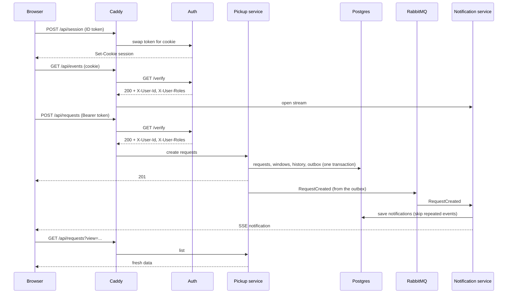

# EcoCollect contracts (Oct 28)

One working flow for the Oct 28 demo: **a resident creates a request, volunteers are notified over SSE, and the screen refetches.**

The messages themselves are written as specs, so this page only covers the flow around them:

| File | What is in it |
|---|---|
| [openapi.yaml](./openapi.yaml) | The public API through the gateway: sessions, requests, the event stream |
| [asyncapi.yaml](./asyncapi.yaml) | The `RequestCreated` event on RabbitMQ and the SSE notification message |
| [schemas/common.yaml](./schemas/common.yaml) | Definitions both specs share (pickup window, postal code, timestamp, status) |

Everything not needed for this flow is in [Deferred](#deferred) at the bottom.

## The flow

1. **Login.** The browser signs in with the Firebase client SDK and reads the roles from the token.
2. **Session.** It calls `POST /api/session` once, then opens the SSE stream. This is the only reason sessions exist: `EventSource` can't send an `Authorization` header, but browsers send cookies by themselves.
3. **Create.** A resident posts the request. Caddy checks the token first, then the pickup service saves one request per category and one outbox row for each, all in one transaction.
4. **Publish.** A loop in the pickup service sends the outbox rows to RabbitMQ and marks them sent only after RabbitMQ confirms.
5. **Notify.** The notification service saves a notification for the resident and for every matched volunteer, acknowledges the message, and writes an SSE message to each open connection of those users.
6. **Refresh.** The SSE message is only a signal. The frontend refetches `GET /api/requests` to show the real data.

## Conventions

- All REST traffic goes through the gateway at `/api/*`. Bodies are JSON.
- Timestamps are ISO 8601 in UTC with a `Z` (`2026-10-28T16:15:00Z`) and stored as `timestamptz`. The frontend converts to Calgary time only for display.
- The exception is a pickup window: a Calgary date plus a start hour (`{ "date": "2026-10-30", "startHour": 14 }` is 14:00 to 15:00 Calgary time), with no time zone, because it is a local hour and not an instant.
- Roles live in Firebase custom claims: `{ roles: ["resident"] | ["volunteer"] | ["resident","volunteer"] }`.
- **No street address ever appears in an event, an SSE message or a volunteer's list.**
- Each service writes only its own tables.
- Caddy is the gateway and the only publicly exposed service. It serves the Next.js frontend and `/api/*` on one origin. Auth is the only backend component that talks to Firebase.

## Setup (manual, one time)

| # | Step | How |
|---|---|---|
| 1 | Roles on Firebase users | The seed script calls `setCustomUserClaims(uid, { roles })`. New claims reach the frontend on the next token refresh (about 1 hour). To apply them now, call `currentUser.getIdToken(true)` and then `POST /api/session` again so the cookie has them too. |
| 2 | Database rows | The seed script, run as an admin user, creates the tables and seeds profiles (address, postal code, volunteer preferred postal codes) and item categories with their standard weight. It replaces registration for Oct 28. |

The seed script creates the Firebase users and their database rows in one run, so the two can't disagree.

## Frontend and Firebase (client SDK)

| # | Call | Notes |
|---|---|---|
| F1 | `signInWithEmailAndPassword(email, password)` | Login screen |
| F2 | `getIdTokenResult()` | Gives the token and `claims.roles`, to decide which role or roles to offer |
| F3 | `getIdToken()` | Called before each API request. The SDK refreshes the token by itself. |
| F4 | `signOut` | First call `DELETE /api/session`, then `signOut` |

The frontend keeps a fixed list of item categories. The ids must match the seeded categories, which the seed script creates as: `laptops`, `desktops`, `monitors`, `tvs`, `phones`, `tablets`, `printers`, `small-appliances`, `cables-chargers`, `other-electronics`. The last one needs an item description, because the database requires it.

## Gateway (Caddy)

| # | Item | Rule |
|---|---|---|
| G1 | Strip client headers | Delete any incoming `X-User-Id`, `X-User-Roles` and `X-Request-Id` before anything else |
| G2 | `forward_auth` | For every `/api/*` route except `/api/session`, Caddy sends `GET /verify` to the auth service with the original `Authorization` and `Cookie` headers (no body). The original request waits. |
| G3 | The reply | `200` plus `X-User-Id` and `X-User-Roles` (comma separated, empty if none) are copied onto the original request. Any other status, such as `401`, goes back to the browser as it is and the request goes no further. |
| G4 | Added by Caddy | `X-Request-Id` from Caddy's generated id, for tracing in logs |
| G5 | Routing | `/api/session` goes to auth, without `forward_auth`. `/api/requests` goes to the pickup service. `/api/events` goes to the notification service. Everything else goes to the Next.js frontend. |
| G6 | SSE route | `/api/events` goes through `forward_auth` and is proxied as usual, but Caddy must stream `text/event-stream` straight back and keep this route out of any compression rule. |
| G7 | HTTPS | Caddy makes certificates by itself (a local one for `localhost`), which the `Secure` session cookie needs |
| G8 | Trust | The backend services are only reachable on the internal network. They trust `X-User-*` without checking Firebase again. |

## Auth service and Firebase (Admin SDK)

The auth module is the one place that talks to Firebase. Its routes are `POST` and `DELETE /api/session` (public, see the OpenAPI file) and `GET /verify` (internal, only Caddy calls it, never exposed).

| # | Call | When | Notes |
|---|---|---|---|
| A1 | `verifyIdToken(token, true)` | `/verify` with a bearer token | Checks the signature, and also asks Firebase so that disabled users and revoked tokens are rejected. Changing claims alone does not revoke a token. |
| A2 | `createSessionCookie(idToken, { expiresIn })` | `POST /api/session` | Expires in 5 days. Needs a recent sign-in. A bad token gives `401`. |
| A3 | `verifySessionCookie(cookie, true)` | `/verify` with no bearer token (only `GET /api/events`) | Same revocation check as A1 |

`/verify` answers `200` with the two headers, `401` when the credentials are missing or rejected, and `500` when Firebase or our own setup failed. A `500` is not a bad token.

## Pickup service and Postgres

| # | Operation | Notes |
|---|---|---|
| P1 | Read the profile and categories | Address, postal code and standard weights. `profiles` is read-only for Oct 28. |
| P2 | Match volunteers | Volunteers whose saved postal codes include the request's postal code, without the resident. It is a snapshot at creation time. |
| P3 | Create, in one transaction | One request per category, its windows, one status change (`Open`) and one outbox row per request. All or nothing. |
| P4 | Read requests | "Available" means status Open, `expiresAt` in the future, and at least one window whose start (`date` plus `startHour`, from Calgary time) is still in the future. |
| P5 | Outbox poll | `SELECT ... WHERE published_at IS NULL ... FOR UPDATE SKIP LOCKED`, in a loop inside the pickup service |
| P6 | Outbox mark sent | `published_at = now()`, only after RabbitMQ confirms |

`expiresAt` is the created time plus 30 days. It only applies while a request is Open. There is no expiry job for Oct 28: the field is stored now, and "available" already respects it.

## RabbitMQ

The message is described in [asyncapi.yaml](./asyncapi.yaml). The setup:

| Item | Value |
|---|---|
| Exchange | `ecocollect.events`, type `topic`, durable |
| Routing key | `request.created` |
| Queue | `notification.request-events`, durable, bound with `request.*` |
| Message | `messageId` is the `eventId`, `application/json`, **persistent**. A durable queue holding non-persistent messages comes back empty after a restart, so both are needed. |
| Publisher | Publisher confirms on. The outbox row is marked sent only after the confirm. |
| Consumer | Manual ack after the database work commits. Unacked messages are delivered again. |
| Granularity | One event per created request |

## Notification service

| # | Step | Notes |
|---|---|---|
| N1 | Insert the `eventId` into `processed_events` | If it is already there, skip. This makes a redelivered event harmless. |
| N2 | Insert the notifications in the same transaction as N1 | One for the resident (`REQUEST_CREATED`) and one per uid in `matchedVolunteerUids` (`NEW_MATCHING_REQUEST`). No matched volunteers means only the resident's row. Ack after commit. |
| N3 | Write to the SSE connections | One `notification` message per saved row, to every open connection of that recipient. The service keeps a `userId` to connections list. A recipient with no open connection gets nothing now. About every 25 seconds the server sends `: ping`, which `EventSource` ignores, to keep proxies from closing the connection and to drop dead ones. |

## Frontend reactions

| # | Trigger | Action |
|---|---|---|
| R1 | Login succeeds | `POST /api/session`, then open `EventSource('/api/events', { withCredentials: true })` |
| R2 | `POST /api/requests` succeeds | Refetch `["requests","mine"]` |
| R3 | SSE `notification` | `NEW_MATCHING_REQUEST` refetches `["requests","available"]`. `REQUEST_CREATED` refetches `["requests","mine"]`. The message is only a signal and the data always comes from the REST API. |
| R4 | SSE drops | `EventSource` reconnects by itself. While it is down, refetch the visible lists every 30 seconds. |
| R5 | A volunteer opens "available" | Call `GET /api/requests?view=available` with no `postalCodes`, to show everything |

## Open points for the team

- **Who gets notified.** The event carries `matchedVolunteerUids`, so only volunteers in the request's area are notified. The thread also said there is no profile call for Oct 28, so the list shows every available request. If the demo should notify all volunteers, the pickup service should put them all in `matchedVolunteerUids`. Please confirm.
- **Category ids.** The frontend list and the seeded categories must use the same ids (listed under Frontend and Firebase). If the seed script changes them, this list and the frontend need the same change.
- **Where the ID token goes.** `POST /api/session` takes it in the JSON body as `{ "idToken": "..." }`. It is not read from a header.

## Deferred

Not part of Oct 28:

| Item | Plan |
|---|---|
| Browser push notifications | VAPID keys, `POST` and `DELETE /api/push/subscriptions`, the service worker, the "Enable notifications" button, and `web-push` sending in the notification service |
| `GET /api/categories` | The frontend keeps a fixed list |
| `GET /api/profile` | Used to build the default postal code filter for volunteers |
| `GET /api/notifications` | Loads notifications missed while offline. No read or unread yet. |
| Mark as read | `PATCH /api/notifications/:id/read` and an `isRead` field, with an SSE `notification-read` event so other tabs stay in step |
| Request expiry | A scheduler marks Open requests Expired when `expiresAt` passes and publishes `RequestExpired` |
| Registration | Replaces manual claims and seeded profiles |
| Photos | Upload on request creation |
| Notification retention | Notifications are kept forever for now. Later, clean up old notifications and old `processed_events` rows. |
