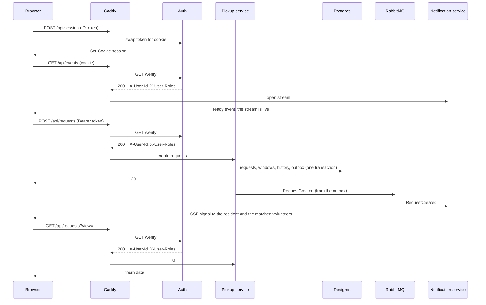

# EcoCollect contracts (Oct 28)

This is the one flow we're demoing on Oct 28: a resident creates a request, the matching volunteers get a live signal over SSE, and their screen refetches.

The exact messages live in the specs, so this page only covers the flow around them.

| File | What's in it |
|---|---|
| [openapi.yaml](./openapi.yaml) | The public API through the gateway: sessions, requests, the event stream |
| [asyncapi.yaml](./asyncapi.yaml) | The `RequestCreated` event on RabbitMQ and the SSE signal message |
| [schemas/common.yaml](./schemas/common.yaml) | What both specs share (pickup window, postal code, timestamp, status) |

Anything we don't need for this flow is under [Deferred](#deferred) at the bottom.

## Checking the specs

```bash
npm install
npm test        # examples, rules and docs agree with each other
npm run lint    # Redocly for OpenAPI, AsyncAPI CLI for AsyncAPI
```

If you change a spec, `npm test` tells you what else has to change with it.

## The flow



1. The browser signs in with the Firebase client SDK and reads the roles from the token.
2. It calls `POST /api/session` once, then opens the SSE stream. Sessions only exist because `EventSource` can't send an `Authorization` header, but browsers send cookies on their own. As soon as the stream is set up, the notification service registers the connection and writes a `ready` event, so the browser's `onopen` fires right away.
3. The resident posts the request. Caddy checks the token, then the pickup service saves one request per category plus an outbox row for each, all in one transaction.
4. A loop in the pickup service sends the outbox rows to RabbitMQ and marks them sent once RabbitMQ confirms. An event is never lost before it reaches RabbitMQ. After that, each consumer decides what it needs.
5. The notification service has no database. It writes an SSE signal to every open connection of the resident and of each matched volunteer, then acks the message. Someone who's offline gets nothing, and catches up because the frontend refetches every time the stream opens.
6. The SSE message is only a signal. The frontend refetches `GET /api/requests` to get the real data.

## Conventions

- REST goes through the gateway at `/api/*`, with JSON bodies.
- Timestamps are ISO 8601 in UTC with a `Z` (`2026-10-28T16:15:00Z`) and stored as `timestamptz`. The frontend only converts to Calgary time for display.
- A pickup window is the exception. It's a Calgary date plus a start hour (`{ "date": "2026-10-30", "startHour": 14 }` is 14:00 to 15:00 Calgary time), with no time zone, because it's a local hour and not an instant.
- Roles are Firebase custom claims: `{ roles: ["resident"] | ["volunteer"] | ["resident","volunteer"] }`.
- Events change carefully. Consumers ignore fields they don't know, so adding a field is safe and keeps `version: 1`. Removing a field, or changing what one means, gets a new `version`.
- A signal is the live "refetch now" ping sent over SSE, and it's never saved. A notification would be a stored inbox record, which is deferred.
- No street address ever appears in an event, an SSE message or a volunteer's list.
- Each service writes only its own tables.
- Caddy is the gateway and the only service exposed publicly. It serves the Next.js frontend and `/api/*` on one origin. Auth is the only part of the backend that talks to Firebase.

## Setup (one time, by hand)

The tables come from `db/init/001_schema.sql`. The seed script then does two things in one run, so Firebase and the database can't disagree:

- It creates the demo users in Firebase and sets their roles with `setCustomUserClaims(uid, { roles })`. New claims reach the frontend on the next token refresh (about an hour). To apply them right away, call `currentUser.getIdToken(true)` and then `POST /api/session` again so the cookie has them too.
- It adds a profile row for each user (address, postal code, preferred postal codes for volunteers) and the item categories with their standard weights. This replaces registration for Oct 28.

## Frontend and Firebase (client SDK)

- `signInWithEmailAndPassword(email, password)` on the login screen.
- `getIdTokenResult()` gives the token and `claims.roles`, to decide which role or roles to offer.
- `getIdToken()` before each API request. The SDK refreshes the token by itself.
- On logout, call `DELETE /api/session` first, then `signOut`.

The frontend keeps a fixed list of item categories, and the ids have to match the seeded ones: `laptops`, `desktops`, `monitors`, `tvs`, `phones`, `tablets`, `printers`, `small-appliances`, `cables-chargers`, `other-electronics`. The last one needs an item description, because the database requires it.

## Gateway (Caddy)

- It first strips any incoming `X-User-Id`, `X-User-Roles` and `X-Request-Id`, so a client can't pretend to be someone else.
- For every `/api/*` route except `/api/session`, it sends `GET /verify` to the auth service with the original `Authorization` and `Cookie` headers (no body) and holds the original request.
- On a `200`, it copies `X-User-Id` and `X-User-Roles` (comma separated, empty if none) onto the original request. Any other status, like `401`, goes straight back to the browser and the request goes no further.
- It adds an `X-Request-Id` for tracing in the logs.
- `/api/session` goes to auth with no `forward_auth`, `/api/requests` goes to the pickup service, `/api/events` goes to the notification service, and everything else goes to the frontend.
- `/api/events` goes through `forward_auth` like the rest, but Caddy has to stream `text/event-stream` straight back, without buffering or compression, so the `ready` event reaches the browser right away.
- Caddy makes its own certificates (a local one for `localhost`), which the `Secure` session cookie needs.
- The backend services are only reachable on the internal network, and they trust `X-User-*` without asking Firebase again.

## Auth service and Firebase (Admin SDK)

The auth module is the only place that talks to Firebase. Its routes are `POST` and `DELETE /api/session` (public, see the OpenAPI file) and `GET /verify` (internal, only Caddy calls it, never exposed). It uses three Firebase calls:

- `verifyIdToken(token, true)` on `/verify` with a bearer token. It checks the signature and also asks Firebase, so disabled users and revoked tokens are rejected. Changing claims alone doesn't revoke a token.
- `createSessionCookie(idToken, { expiresIn })` on `POST /api/session`. The cookie lasts 5 days, and this needs a recent sign-in. A bad token gives `401`.
- `verifySessionCookie(cookie, true)` on `/verify` when there's no bearer token (only `GET /api/events`). Same revocation check.

`/verify` answers `200` with the two headers, `401` when the credentials are missing or rejected, and `500` when Firebase or our own setup failed. A `500` doesn't mean a bad token.

## Pickup service and Postgres

- It reads the profile and the categories (address, postal code, standard weights). `profiles` is read-only for Oct 28.
- To match volunteers, it takes the ones whose saved postal codes include the request's postal code, without the resident. That's a snapshot from when the request was created.
- A request is created in one transaction: one request per category, its windows, one status change (`Open`) and one outbox row per request. All or nothing.
- "Available" means status Open, `expiresAt` in the future, and at least one window whose start (`date` plus `startHour`, Calgary time) is still ahead.
- The outbox loop picks rows with `SELECT ... WHERE published_at IS NULL ... FOR UPDATE SKIP LOCKED`, and sets `published_at = now()` only after RabbitMQ confirms.

`expiresAt` is the created time plus 30 days, and it only matters while a request is Open. There's no expiry job for Oct 28. The field is stored now and "available" already respects it.

## RabbitMQ

The message itself is described in [asyncapi.yaml](./asyncapi.yaml). The setup:

| Item | Value |
|---|---|
| Exchange | `ecocollect.events`, type `topic`, durable |
| Routing key | `request.created` |
| Queue | One per notification instance, declared by that instance when it starts: exclusive, auto-delete, not durable, named by the broker, bound with `request.*`. Every instance gets every event. With one shared queue each event would go to only one instance, and that one might not hold the user's SSE connection. |
| Message | `messageId` is the `eventId`, `application/json`, persistent. The notification queues don't survive a restart, but a consumer that needs that (stored notifications, email) can add a durable queue without changing anything here. |
| Publisher | Publisher confirms on, and the outbox row is marked sent only after the confirm. |
| Consumer | Manual ack once the SSE signals are written. Events published while no notification instance is running are dropped, which is fine for signals. |
| Granularity | One event per created request |

## Notification service

A small stateless service with no database for Oct 28. It turns each `RequestCreated` event into SSE signals for the users who are online.

- At startup it declares its own queue and binds it to `ecocollect.events` with `request.*`.
- For each event it reads the recipients from the event itself: `data.residentUid` and `data.matchedVolunteerUids`. There's no matching and no lookup.
- When a stream opens, it registers the connection first and then writes a `ready` event (`event: ready`, `data: {}`) straight away. That flushes the headers, so `onopen` fires at once instead of after the first ping, and the refetch that follows can't miss a signal.
- It writes `NEW_MATCHING_REQUEST` to every open connection of each matched volunteer, and `REQUEST_CREATED` to every open connection of the resident. It keeps a `userId` to connections list in memory. With no matched volunteers, only the resident gets a signal. About every 25 seconds it sends `: ping`, which `EventSource` ignores, to keep proxies from closing the connection and to spot dead ones.
- Then it acks. A repeated delivery sends the signal again, which only costs an extra refetch, so there's no check for repeats.

## Frontend reactions

- After login: `POST /api/session`, then open `EventSource('/api/events', { withCredentials: true })`.
- After `POST /api/requests` succeeds: refetch `["requests","mine"]`.
- On an SSE `signal`: `NEW_MATCHING_REQUEST` refetches `["requests","available"]` and `REQUEST_CREATED` refetches `["requests","mine"]`. The message is only a signal, and the data always comes from the REST API.
- Whenever the stream opens (`onopen`), the first time or after a reconnect: refetch the lists on screen. The server writes the `ready` event right away, so this happens as soon as the stream is up. The frontend can also listen for `ready`, but it doesn't have to. That's the whole recovery plan. Missed signals aren't replayed, and `EventSource` reconnects by itself.
- When a volunteer opens "available": call `GET /api/requests?view=available` with no `postalCodes`, to show everything.

## Open points for the team

- **Who gets notified.** The event carries `matchedVolunteerUids` and issue #25 sends to exactly those uids, so only volunteers in the request's area get notified. The thread also said there's no profile call for Oct 28, so the list shows every available request. If the demo should notify all volunteers, the pickup service has to put them all in `matchedVolunteerUids`. Can we confirm which one we want?
- **Category ids.** The frontend list and the seeded categories have to use the same ids (listed under Frontend and Firebase). If the seed script changes them, this list and the frontend need the same change.
- **Where the ID token goes.** `POST /api/session` takes it in the JSON body as `{ "idToken": "..." }`, not from a header.

## Deferred

Not part of Oct 28:

| Item | Plan |
|---|---|
| Browser push notifications | VAPID keys, `POST` and `DELETE /api/push/subscriptions`, the service worker, the "Enable notifications" button, and `web-push` sending in the notification service |
| `GET /api/categories` | The frontend keeps a fixed list |
| `GET /api/profile` | Used to build the default postal code filter for volunteers |
| Stored notifications | An inbox (`GET /api/notifications`, read and unread, cleaning up old ones) only if we decide users need to see what they missed. Oct 28 uses signals and refetching instead. |
| Request expiry | A scheduler marks Open requests Expired when `expiresAt` passes and publishes `RequestExpired` |
| Registration | Replaces manual claims and seeded profiles |
| Photos | Upload on request creation |
