# FR06: Create Pickup Requests

<table>
  <tr><th colspan="4">TC001 &ensp; Create one request per category &ensp; (Common case)</th></tr>
  <tr><th>Preconditions</th><td colspan="3">Seeded resident, current terms and the phones and laptops categories.</td></tr>
  <tr><th rowspan="4">Procedure</th><th>#</th><th>Action</th><th>Expected Result</th></tr>
  <tr><td>1</td><td>Submit Q4 with two phones and three laptops and valid pickup details.</td><td>HTTP 201 with two distinct request IDs.</td></tr>
  <tr><td>2</td><td>Check the status and computed weight of each row.</td><td>Both are Open. Phones weigh 0.40 kg and laptops weigh 7.50 kg.</td></tr>
  <tr><td>3</td><td>Read both IDs through Q8.</td><td>Both details are available to the resident.</td></tr>
  <tr><th>Expected Result</th><td colspan="3">1. HTTP 201 with two distinct request IDs. 2. Both are Open. Phones weigh 0.40 kg and laptops weigh 7.50 kg. 3. Both details are available to the resident.</td></tr>
  <tr><th>Postcondition</th><td colspan="3">Two distinct requests are stored and visible to their owner.</td></tr>
  <tr><th>Actual Result</th><td colspan="3">Q4 returned 201 with both expected weights and statuses. Q8 returned both requests.</td></tr>
  <tr><th>Status</th><td colspan="3">Pass</td></tr>
</table>

**Evidence for TC001:**

The request list shows both new category requests.

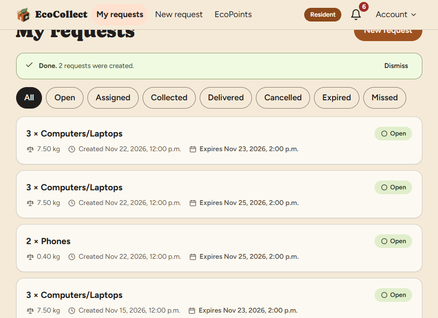

<table>
  <tr><th colspan="4">TC002 &ensp; Reject a repeated category &ensp; (Error case)</th></tr>
  <tr><th>Preconditions</th><td colspan="3">Seeded resident with an existing Q5 list and a valid Q4 body.</td></tr>
  <tr><th rowspan="4">Procedure</th><th>#</th><th>Action</th><th>Expected Result</th></tr>
  <tr><td>1</td><td>Record the resident’s Q5 list.</td><td>The initial list returns HTTP 200.</td></tr>
  <tr><td>2</td><td>Submit Q4 with the same category in both items.</td><td>HTTP 400 validation_failed identifies items[1].categoryId.</td></tr>
  <tr><td>3</td><td>Read the resident’s Q5 list again.</td><td>The list matches the initial response.</td></tr>
  <tr><th>Expected Result</th><td colspan="3">1. The initial list returns HTTP 200. 2. HTTP 400 validation_failed identifies items[1].categoryId. 3. The list matches the initial response.</td></tr>
  <tr><th>Postcondition</th><td colspan="3">No duplicate request is created.</td></tr>
  <tr><th>Actual Result</th><td colspan="3">Q4 rejected the duplicate category. The Q5 response was unchanged.</td></tr>
  <tr><th>Status</th><td colspan="3">Pass</td></tr>
</table>

**Evidence for TC002:**

# FR07: Pickup Scheduling

<table>
  <tr><th colspan="4">TC003 &ensp; Schedule future Calgary windows &ensp; (Common case)</th></tr>
  <tr><th>Preconditions</th><td colspan="3">Seeded resident with the Calgary profile address 100 Example Street SW, T2P1J9.</td></tr>
  <tr><th rowspan="4">Procedure</th><th>#</th><th>Action</th><th>Expected Result</th></tr>
  <tr><td>1</td><td>Submit Q4 with noon tomorrow and 14:00 the next day in Calgary.</td><td>The request is accepted with HTTP 201.</td></tr>
  <tr><td>2</td><td>Read the new requests through Q8.</td><td>The saved dates and start hours match the submitted slots.</td></tr>
  <tr><td>3</td><td>Check the pickup address in the returned details.</td><td>The pickup address matches the resident profile.</td></tr>
  <tr><th>Expected Result</th><td colspan="3">1. The request is accepted with HTTP 201. 2. The saved dates and start hours match the submitted slots. 3. The pickup address matches the resident profile.</td></tr>
  <tr><th>Postcondition</th><td colspan="3">The Calgary windows and profile address are retrievable on the created requests.</td></tr>
  <tr><th>Actual Result</th><td colspan="3">Q8 returned the two expected local slots and the seeded pickup address for both requests.</td></tr>
  <tr><th>Status</th><td colspan="3">Pass</td></tr>
</table>

**Evidence for TC003:**

The review shows two Calgary pickup windows and the pickup address.

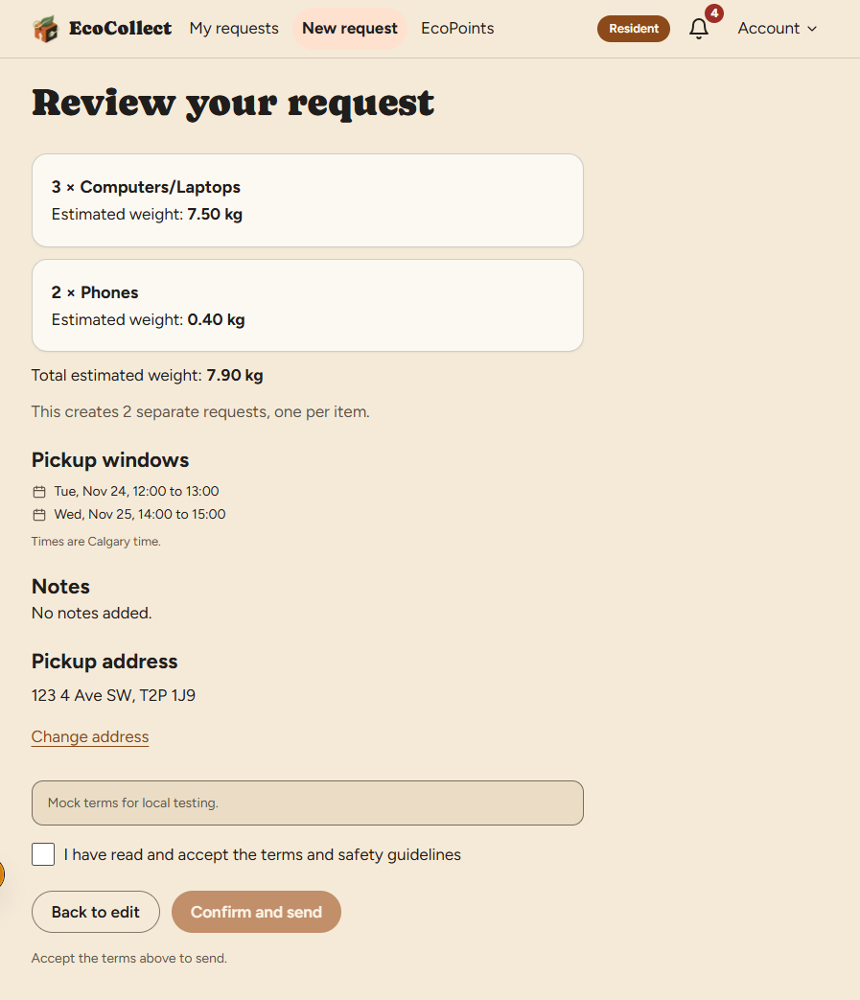

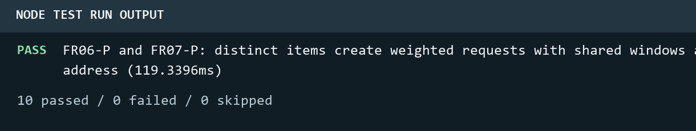

<table>
  <tr><th colspan="4">TC004 &ensp; Reject a past Calgary window &ensp; (Error case)</th></tr>
  <tr><th>Preconditions</th><td colspan="3">Seeded resident, a valid item and terms, and the current Calgary date.</td></tr>
  <tr><th rowspan="4">Procedure</th><th>#</th><th>Action</th><th>Expected Result</th></tr>
  <tr><td>1</td><td>Record the resident’s Q5 list.</td><td>The initial list returns HTTP 200.</td></tr>
  <tr><td>2</td><td>Submit Q4 with yesterday at noon in Calgary.</td><td>HTTP 400 validation_failed reports that the window must start in the future.</td></tr>
  <tr><td>3</td><td>Read Q5 again.</td><td>The list has not changed.</td></tr>
  <tr><th>Expected Result</th><td colspan="3">1. The initial list returns HTTP 200. 2. HTTP 400 validation_failed reports that the window must start in the future. 3. The list has not changed.</td></tr>
  <tr><th>Postcondition</th><td colspan="3">The past-window submission creates no new request.</td></tr>
  <tr><th>Actual Result</th><td colspan="3">Q4 returned the expected future-window error. Q5 was unchanged.</td></tr>
  <tr><th>Status</th><td colspan="3">Pass</td></tr>
</table>

**Evidence for TC004:**

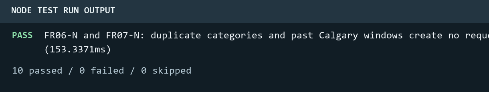

# FR08: Review and Confirm Pickup Requests

<table>
  <tr><th colspan="4">TC005 &ensp; Correct a draft before confirming &ensp; (Common case)</th></tr>
  <tr><th>Preconditions</th><td colspan="3">The resident request form is open with a profile address, current terms, and item categories available.</td></tr>
  <tr><th rowspan="4">Procedure</th><th>#</th><th>Action</th><th>Expected Result</th></tr>
  <tr><td>1</td><td>Enter two laptops and a valid window, then open Review.</td><td>The review shows two laptops. No API submission occurs.</td></tr>
  <tr><td>2</td><td>Go back, change quantity to three, and reopen Review.</td><td>The review shows three laptops. No submission occurs yet.</td></tr>
  <tr><td>3</td><td>Accept the terms and choose Confirm and send.</td><td>One request is submitted with quantity three.</td></tr>
  <tr><th>Expected Result</th><td colspan="3">1. The review shows two laptops. No API submission occurs. 2. The review shows three laptops. No submission occurs yet. 3. One request is submitted with quantity three.</td></tr>
  <tr><th>Postcondition</th><td colspan="3">The form sends the corrected draft once, after confirmation.</td></tr>
  <tr><th>Actual Result</th><td colspan="3">The review showed three laptops. After confirmation, the request appeared in My requests with quantity three.</td></tr>
  <tr><th>Status</th><td colspan="3">Pass</td></tr>
</table>

**Evidence for TC005:**

The review shows the corrected quantity of three laptops.

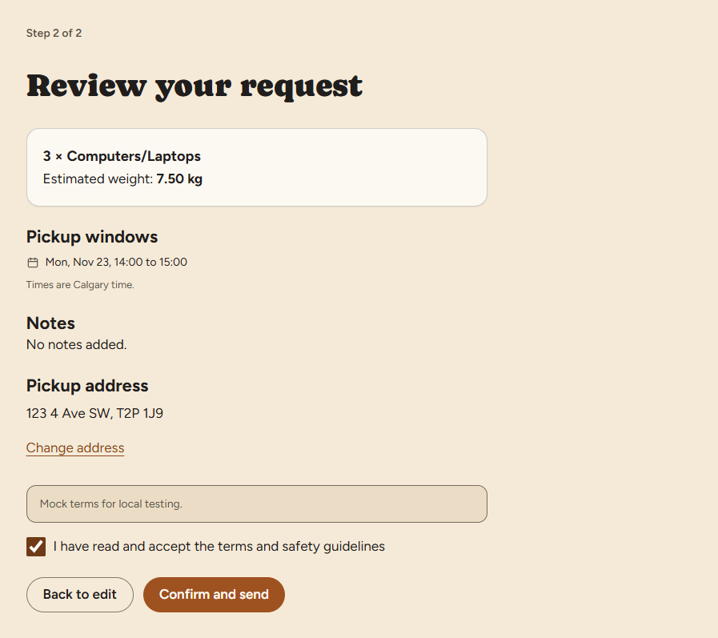

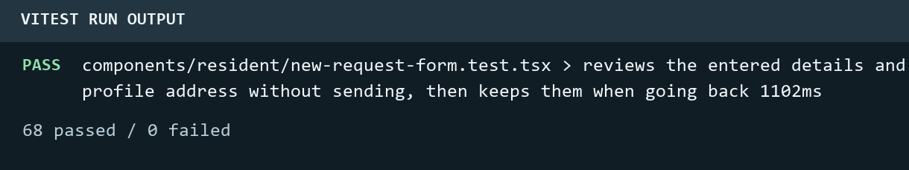

<table>
  <tr><th colspan="4">TC006 &ensp; Block confirmation without accepting terms &ensp; (Error case)</th></tr>
  <tr><th>Preconditions</th><td colspan="3">A valid pickup request draft is ready for review and the current terms are available.</td></tr>
  <tr><th rowspan="3">Procedure</th><th>#</th><th>Action</th><th>Expected Result</th></tr>
  <tr><td>1</td><td>Open Review and leave the terms checkbox unchecked.</td><td>Confirm and send is disabled.</td></tr>
  <tr><td>2</td><td>Attempt to submit the draft without accepting the terms.</td><td>No request is sent.</td></tr>
  <tr><th>Expected Result</th><td colspan="3">1. Confirm and send is disabled. 2. No request is sent.</td></tr>
  <tr><th>Postcondition</th><td colspan="3">The draft is not submitted.</td></tr>
  <tr><th>Actual Result</th><td colspan="3">Confirm and send stayed disabled, and the draft was not submitted.</td></tr>
  <tr><th>Status</th><td colspan="3">Pass</td></tr>
</table>

**Evidence for TC006:**

Confirm and send stays disabled while the terms checkbox is unchecked.

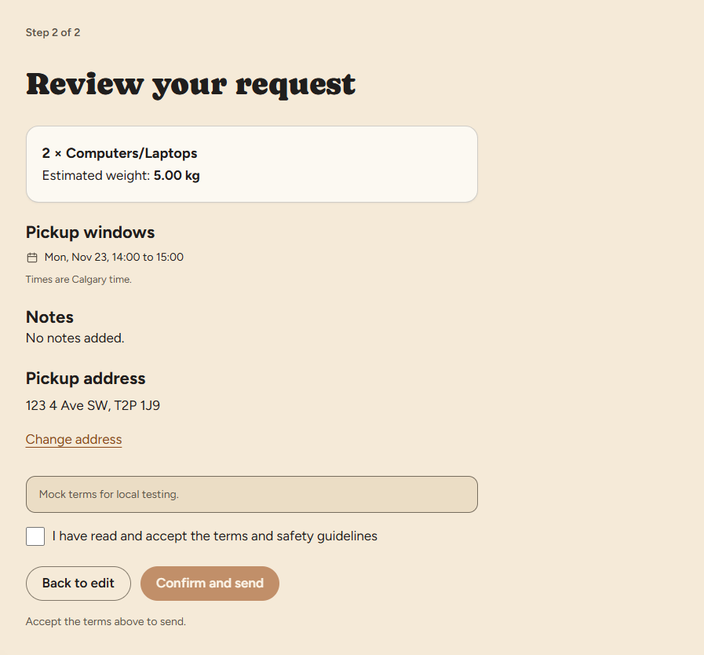

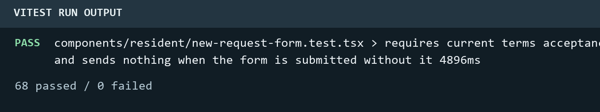

# FR09: View Resident Pickup Requests

<table>
  <tr><th colspan="4">TC007 &ensp; Filter the resident?s requests by status &ensp; (Common case)</th></tr>
  <tr><th>Preconditions</th><td colspan="3">The seeded resident has Open and Delivered requests.</td></tr>
  <tr><th rowspan="3">Procedure</th><th>#</th><th>Action</th><th>Expected Result</th></tr>
  <tr><td>1</td><td>Fetch the resident’s unfiltered Q5 list.</td><td>HTTP 200 with the contract shape, newest first.</td></tr>
  <tr><td>2</td><td>Filter the Q5 list to Open and Assigned.</td><td>The Open request appears and the Delivered request is excluded.</td></tr>
  <tr><th>Expected Result</th><td colspan="3">1. HTTP 200 with the contract shape, newest first. 2. The Open request appears and the Delivered request is excluded.</td></tr>
  <tr><th>Postcondition</th><td colspan="3">The filter returns matching requests without modifying their state.</td></tr>
  <tr><th>Actual Result</th><td colspan="3">The filtered list showed the Open request and excluded the Delivered request.</td></tr>
  <tr><th>Status</th><td colspan="3">Pass</td></tr>
</table>

**Evidence for TC007:**

The Open filter shows only Open requests.

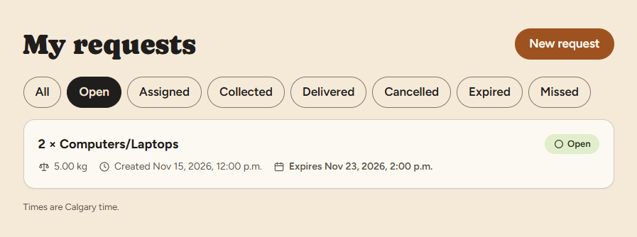

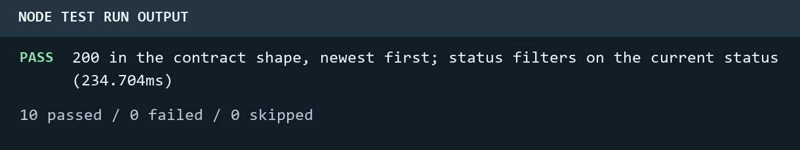

<table>
  <tr><th colspan="4">TC008 &ensp; Exclude another resident?s request &ensp; (Error case)</th></tr>
  <tr><th>Preconditions</th><td colspan="3">Two different seeded resident accounts.</td></tr>
  <tr><th rowspan="3">Procedure</th><th>#</th><th>Action</th><th>Expected Result</th></tr>
  <tr><td>1</td><td>Create a request as the second resident and read their Q5 list.</td><td>The second resident can see the new request.</td></tr>
  <tr><td>2</td><td>Read Q5 as the first resident.</td><td>HTTP 200 lists the first resident’s own request but omits the second resident’s request.</td></tr>
  <tr><th>Expected Result</th><td colspan="3">1. The second resident can see the new request. 2. HTTP 200 lists the first resident’s own request but omits the second resident’s request.</td></tr>
  <tr><th>Postcondition</th><td colspan="3">Each resident’s list respects request ownership.</td></tr>
  <tr><th>Actual Result</th><td colspan="3">The new request was visible to its owner and absent from the other resident’s list.</td></tr>
  <tr><th>Status</th><td colspan="3">Pass</td></tr>
</table>

**Evidence for TC008:**

# FR10: Edit Open Pickup Requests

<table>
  <tr><th colspan="4">TC009 &ensp; Edit an Open request &ensp; (Common case)</th></tr>
  <tr><th>Preconditions</th><td colspan="3">An Open phone request owned by the seeded resident and a valid later replacement window.</td></tr>
  <tr><th rowspan="4">Procedure</th><th>#</th><th>Action</th><th>Expected Result</th></tr>
  <tr><td>1</td><td>Read the original Q8 details.</td><td>The original address and expiry are available.</td></tr>
  <tr><td>2</td><td>Patch the quantity to two and replace the pickup window.</td><td>Q9 returns HTTP 200 with the new quantity and window.</td></tr>
  <tr><td>3</td><td>Read Q8 and inspect the outbox.</td><td>Weight is 0.40 kg, expiry moves later, address is preserved, and RequestUpdated is recorded.</td></tr>
  <tr><th>Expected Result</th><td colspan="3">1. The original address and expiry are available. 2. Q9 returns HTTP 200 with the new quantity and window. 3. Weight is 0.40 kg, expiry moves later, address is preserved, and RequestUpdated is recorded.</td></tr>
  <tr><th>Postcondition</th><td colspan="3">The edit persists and has an update record in the outbox.</td></tr>
  <tr><th>Actual Result</th><td colspan="3">The saved quantity, weight, address, window and expiry matched the expected changes. The outbox included RequestUpdated.</td></tr>
  <tr><th>Status</th><td colspan="3">Pass</td></tr>
</table>

**Evidence for TC009:**

The request details show the saved quantity and recalculated weight.

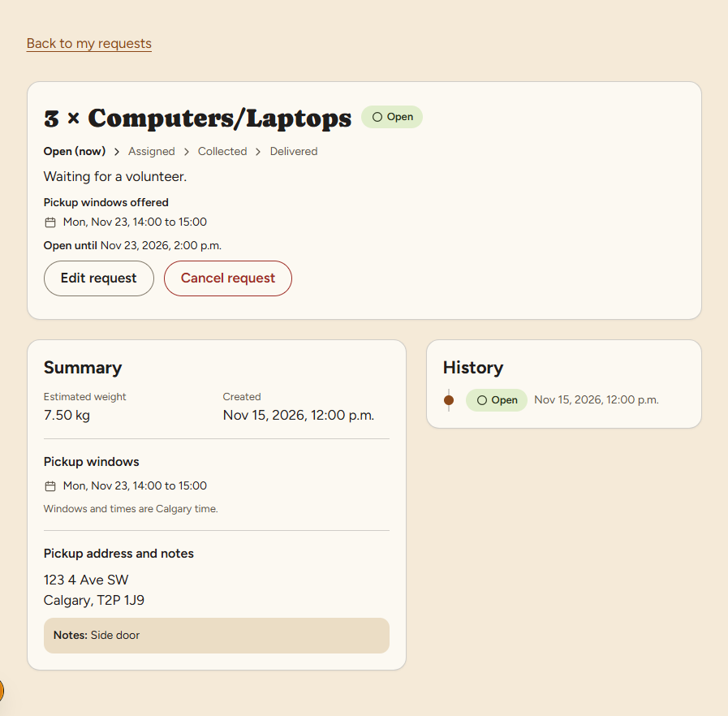

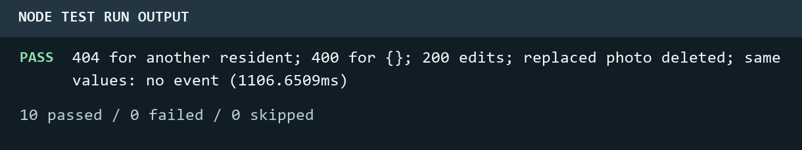

<table>
  <tr><th colspan="4">TC010 &ensp; Reject edits when the request is expired &ensp; (Error case)</th></tr>
  <tr><th>Preconditions</th><td colspan="3">The resident owns an Open request whose last pickup window has already started.</td></tr>
  <tr><th rowspan="4">Procedure</th><th>#</th><th>Action</th><th>Expected Result</th></tr>
  <tr><td>1</td><td>Try changing quantity to two.</td><td>HTTP 409 expired. RequestExpired is recorded.</td></tr>
  <tr><td>2</td><td>Try the same edit again.</td><td>HTTP 409 not_open.</td></tr>
  <tr><td>3</td><td>Read Q8 and inspect the outbox.</td><td>The status is Expired, quantity remains one, and no RequestUpdated is recorded.</td></tr>
  <tr><th>Expected Result</th><td colspan="3">1. HTTP 409 expired. RequestExpired is recorded. 2. HTTP 409 not_open. 3. The status is Expired, quantity remains one, and no RequestUpdated is recorded.</td></tr>
  <tr><th>Postcondition</th><td colspan="3">The requested edit is never applied.</td></tr>
  <tr><th>Actual Result</th><td colspan="3">Both edit attempts were rejected. The request was Expired with quantity one and no update event.</td></tr>
  <tr><th>Status</th><td colspan="3">Pass</td></tr>
</table>

**Evidence for TC010:**

The Expired request details have no edit action.

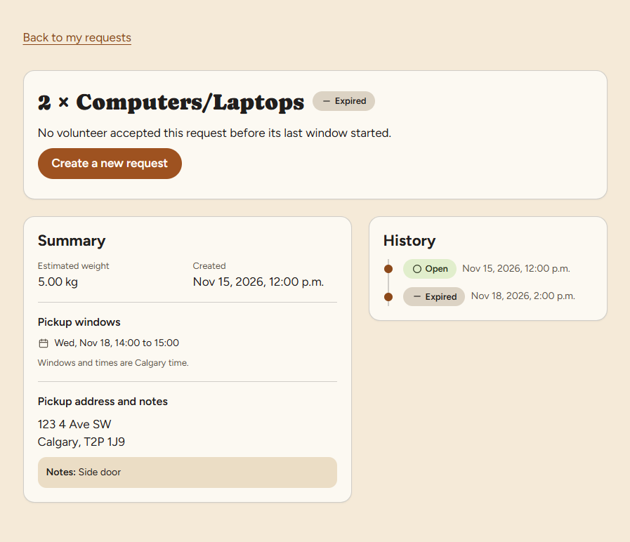

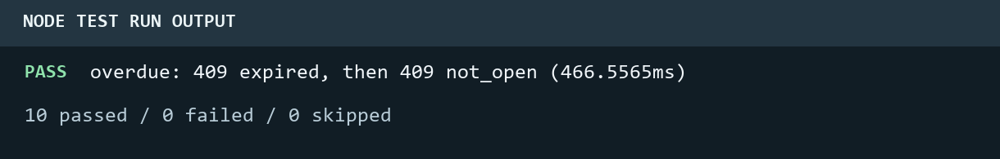
