## FR06: Create Pickup Requests

### Common case (FR06-P)

| Field | Details |
| --- | --- |
| Preconditions | Seeded resident, current terms and the phones and laptops categories. |
| Postcondition | Two distinct requests are stored and visible to their owner. |
| Actual result | Q4 returned 201 with both expected weights and statuses. Q8 returned both requests. |
| Status | Pass |

| Step | Action | Expected result |
| --- | --- | --- |
| 1 | Submit Q4 with two phones and three laptops and valid pickup details. | HTTP 201 with two distinct request IDs. |
| 2 | Check the status and computed weight of each row. | Both are Open. Phones weigh 0.40 kg and laptops weigh 7.50 kg. |
| 3 | Read both IDs through Q8. | Both details are available to the resident. |

**Evidence**

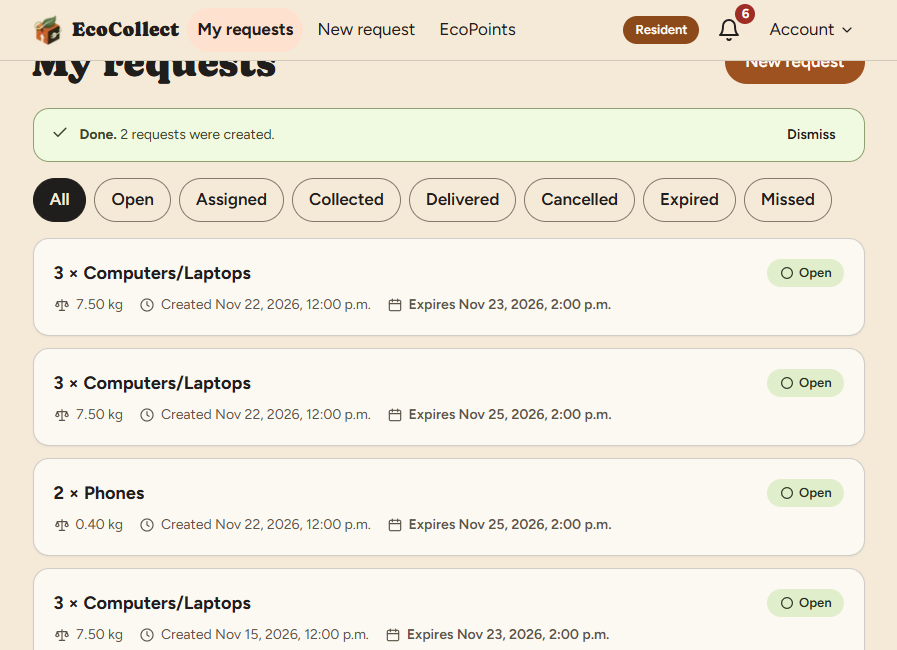

### Error case (FR06-N)

| Field | Details |
| --- | --- |
| Preconditions | Seeded resident with an existing Q5 list and a valid Q4 body. |
| Postcondition | No duplicate request is created. |
| Actual result | Q4 rejected the duplicate category. The Q5 response was unchanged. |
| Status | Pass |

| Step | Action | Expected result |
| --- | --- | --- |
| 1 | Record the resident’s Q5 list. | The initial list returns HTTP 200. |
| 2 | Submit Q4 with the same category in both items. | HTTP 400 validation_failed identifies items[1].categoryId. |
| 3 | Read the resident’s Q5 list again. | The list matches the initial response. |

**Evidence**

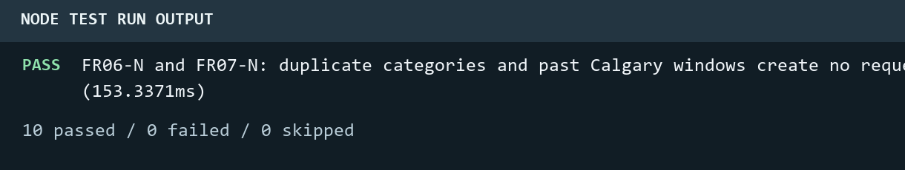

## FR07: Pickup Scheduling

### Common case (FR07-P)

| Field | Details |
| --- | --- |
| Preconditions | Seeded resident with the Calgary profile address 100 Example Street SW, T2P1J9. |
| Postcondition | The Calgary windows and profile address are retrievable on the created requests. |
| Actual result | Q8 returned the two expected local slots and the seeded pickup address for both requests. |
| Status | Pass |

| Step | Action | Expected result |
| --- | --- | --- |
| 1 | Submit Q4 with noon tomorrow and 14:00 the next day in Calgary. | The request is accepted with HTTP 201. |
| 2 | Read the new requests through Q8. | The saved dates and start hours match the submitted slots. |
| 3 | Check the pickup address in the returned details. | The pickup address matches the resident profile. |

**Evidence**

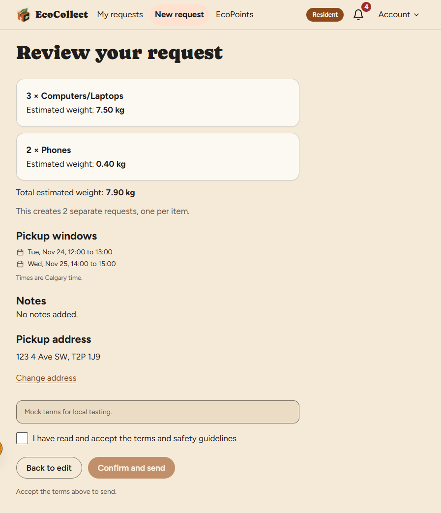

### Error case (FR07-N)

| Field | Details |
| --- | --- |
| Preconditions | Seeded resident, a valid item and terms, and the current Calgary date. |
| Postcondition | The past-window submission creates no new request. |
| Actual result | Q4 returned the expected future-window error. Q5 was unchanged. |
| Status | Pass |

| Step | Action | Expected result |
| --- | --- | --- |
| 1 | Record the resident’s Q5 list. | The initial list returns HTTP 200. |
| 2 | Submit Q4 with yesterday at noon in Calgary. | HTTP 400 validation_failed reports that the window must start in the future. |
| 3 | Read Q5 again. | The list has not changed. |

**Evidence**

## FR08: Review and Confirm Pickup Requests

### Common case (FR08-P)

| Field | Details |
| --- | --- |
| Preconditions | Resident request form with a mocked profile, current terms and categories. |
| Postcondition | The form sends the corrected draft once, after confirmation. |
| Actual result | The review displayed three laptops and the mocked API received exactly one submission with quantity three. |
| Status | Pass |

| Step | Action | Expected result |
| --- | --- | --- |
| 1 | Enter two laptops and a valid window, then open Review. | The review shows two laptops. No API submission occurs. |
| 2 | Go back, change quantity to three, and reopen Review. | The review shows three laptops. No submission occurs yet. |
| 3 | Accept the terms and choose Confirm and send. | One request is submitted with quantity three. |

**Evidence**

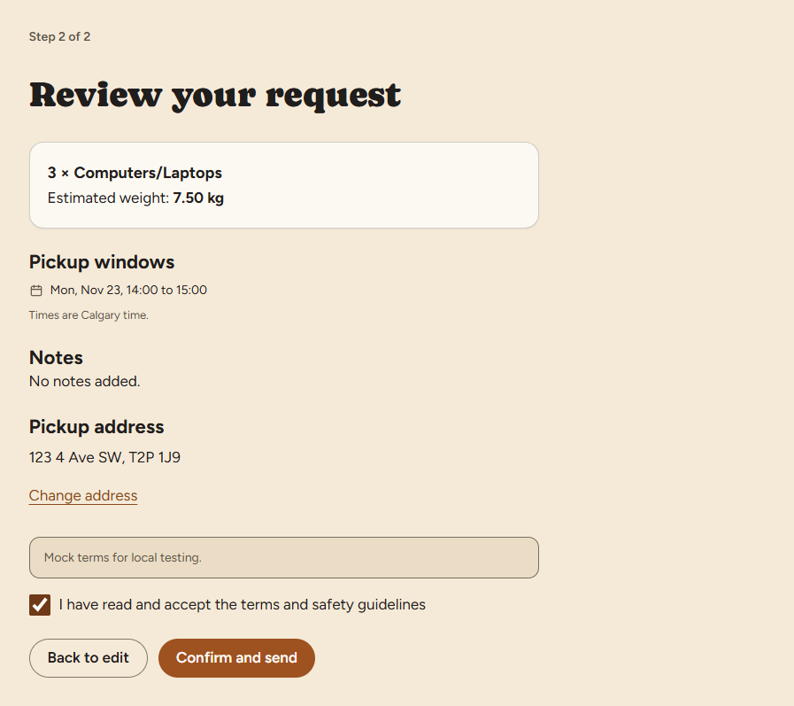

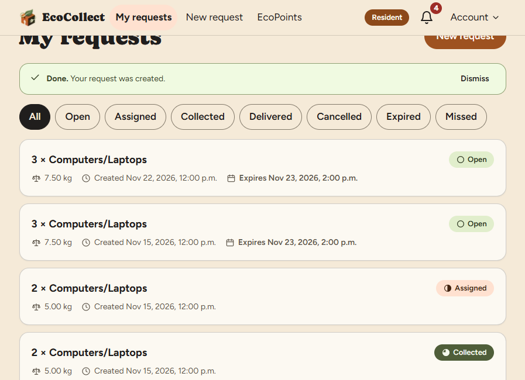

### Error case (FR08-N)

| Field | Details |
| --- | --- |
| Preconditions | Resident request form with a valid draft ready for review and mocked current terms. |
| Postcondition | The draft is not submitted. |
| Actual result | Confirm stayed disabled and the API mock recorded zero calls for the attempted submission. |
| Status | Pass |

| Step | Action | Expected result |
| --- | --- | --- |
| 1 | Open Review and leave the terms checkbox unchecked. | Confirm and send is disabled. |
| 2 | Trigger form submission and inspect the API mock. | No request is sent. |

**Evidence**

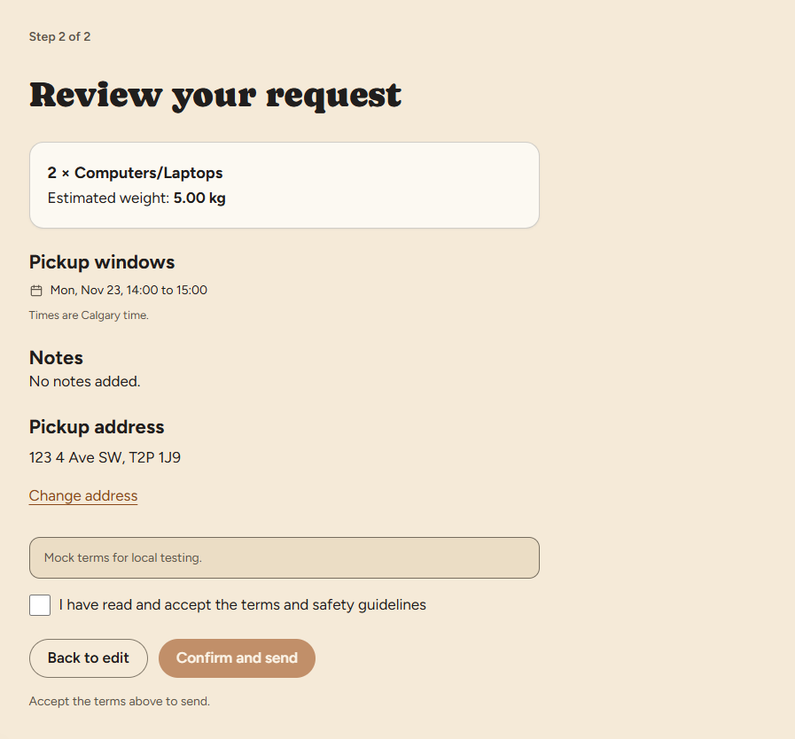

## FR09: View Resident Pickup Requests

### Common case (FR09-P)

| Field | Details |
| --- | --- |
| Preconditions | The seeded resident has Open and Delivered requests. |
| Postcondition | The filter returns matching requests without modifying their state. |
| Actual result | The filtered response included the Open fixture and excluded the Delivered fixture. |
| Status | Pass |

| Step | Action | Expected result |
| --- | --- | --- |
| 1 | Fetch the resident’s unfiltered Q5 list. | HTTP 200 with the contract shape, newest first. |
| 2 | Filter the Q5 list to Open and Assigned. | The Open fixture is listed and the Delivered fixture is excluded. |

**Evidence**

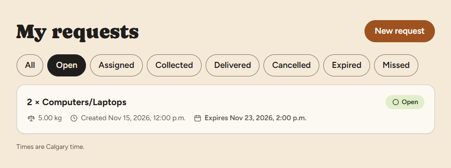

### Error case (FR09-N)

| Field | Details |
| --- | --- |
| Preconditions | Two different seeded resident accounts. |
| Postcondition | Each resident’s list respects request ownership. |
| Actual result | The new request was visible to its owner and absent from the other resident’s list. |
| Status | Pass |

| Step | Action | Expected result |
| --- | --- | --- |
| 1 | Create a request as the second resident and read their Q5 list. | The second resident can see the new request. |
| 2 | Read Q5 as the first resident. | HTTP 200 lists the first resident’s own fixture but omits the second resident’s request. |

**Evidence**

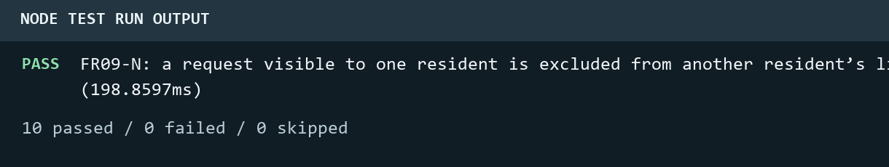

## FR10: Edit Open Pickup Requests

### Common case (FR10-P)

| Field | Details |
| --- | --- |
| Preconditions | An Open phone request owned by the seeded resident and a valid later replacement window. |
| Postcondition | The edit persists and has an update record in the outbox. |
| Actual result | The saved quantity, weight, address, window and expiry matched the expected changes. The outbox included RequestUpdated. |
| Status | Pass |

| Step | Action | Expected result |
| --- | --- | --- |
| 1 | Read the original Q8 details. | The original address and expiry are available. |
| 2 | Patch the quantity to two and replace the pickup window. | Q9 returns HTTP 200 with the new quantity and window. |
| 3 | Read Q8 and inspect the outbox. | Weight is 0.40 kg, expiry moves later, address is preserved, and RequestUpdated is recorded. |

**Evidence**

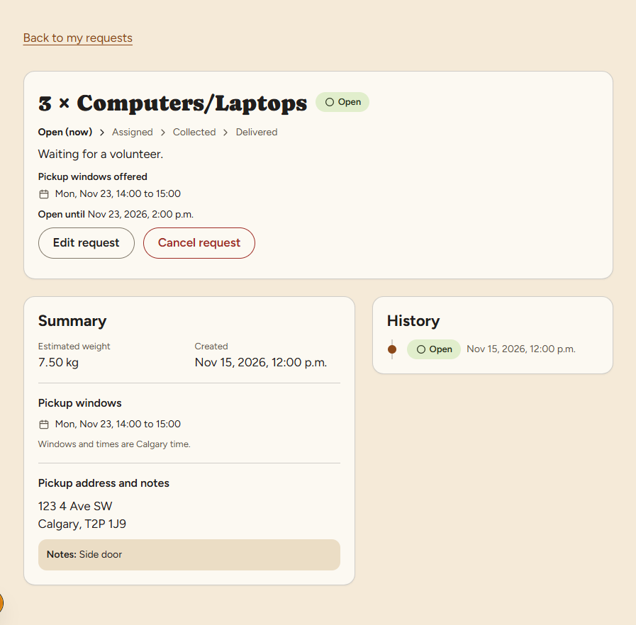

### Error case (FR10-N)

| Field | Details |
| --- | --- |
| Preconditions | An owner’s Open request whose fixture timeline has been moved into the past. |
| Postcondition | The requested edit is never applied. |
| Actual result | Both edit attempts were rejected. The request was Expired with quantity one and no update event. |
| Status | Pass |

| Step | Action | Expected result |
| --- | --- | --- |
| 1 | Try changing quantity to two. | HTTP 409 expired. RequestExpired is recorded. |
| 2 | Try the same edit again. | HTTP 409 not_open. |
| 3 | Read Q8 and inspect the outbox. | The status is Expired, quantity remains one, and no RequestUpdated is recorded. |

**Evidence**

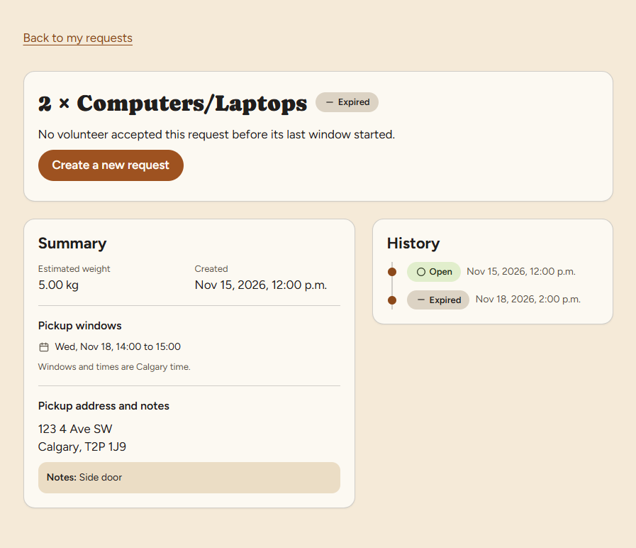

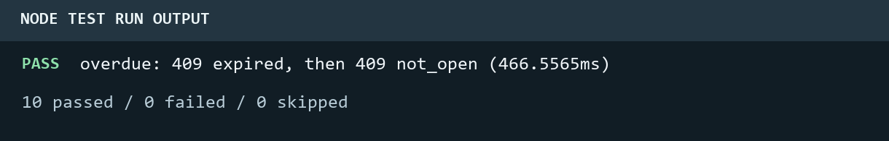
