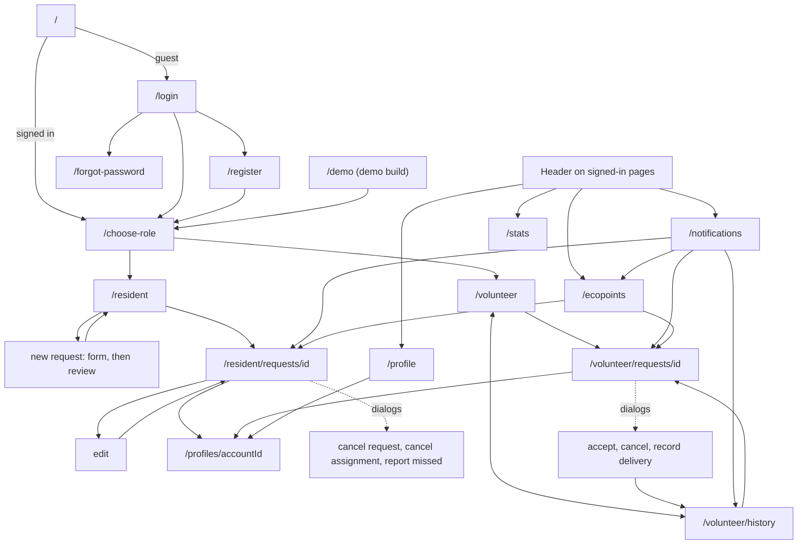

# C. Screen-by-screen audit

**Verification codes:** **S** swept at 375 and 1280 px (axe, console, overflow, screenshot) · **E** existing browser suite · **J** scripted journey · **U** has unit tests (all pass) · **D** dialog or panel scanned open at 375 px. Mock API only. Screen readers and real devices: not verified for any screen.

Common to all screens: shared page title (A11Y-01); skip link works; no horizontal overflow; Calgary-time formatting. "Responsive: OK" means no overflow at the widths tested.

## Shell

**Header, bottom bar, Account menu, More sheet** — `components/app-header.tsx` · all users
- Purpose: navigation. Desktop (≥960): role links, role switch, bell, Account (Community stats, Profile, Log out). Phone: header with role badge and bell; bottom bar with three links and More.
- Behaviour: menus close on navigation; Escape returns focus; More is a modal sheet. Two-role switch navigates to that role's home.
- Visual/a11y: current page shown by weight plus a bar or fill; forced colours lose the selection (A11Y-06). Signed-out header wraps at 375 (UI-02).
- Issues: NAV-07, A11Y-03, UI-02. Verified: S E J D(More) U.

## Public screens

**`/` root** — all. Redirects: guest → `/login`; signed in → role home. States: loading while auth resolves. Verified: S E.

**`/login`** — guests (signed-in users go to `/choose-role`; demo build → `/demo`). FR02.
- Entry: root, header, guards, expiry (`?expired=1` shows "Please sign in again."). Exit: register, forgot password, stats, role choice.
- Forms: email and password with `autocomplete` and native `required` validation; password show/hide; error alert.
- Responsive: OK. States: busy button, error. Issues: NAV-03, NAV-04, UI-04. Improvement: none beyond these.
- Verified: S E J(R3) U. Real Firebase errors: not verified.

**`/register`** — guests (demo → `/demo`). FR01, FR22.
- Cards: role, about you, account, role details; terms; submit disabled until accepted, with a hint.
- A11y: labels, hints, focus moves to first error (R1); live note when role changes.
- Autocomplete and input types set. States: busy, server field errors, account-created-but-sign-in-failed warning, terms loading/error.
- Issues: NAV-02, FORM-04. Verified: S E J(R1, R2) U.

**`/forgot-password`** — guests (demo → `/demo`). FR02 (contract 3.4).
- Same confirmation whether or not the email exists. Back link to sign in. States: busy, success, four error messages.
- Issues: UI-02, UI-04; A11Y-04 applies to its messages. Verified: S E U. Real email: not verified.

**`/demo`** — demo build only (otherwise 404). FR24.
- Start demo, link to stats; banner on all demo pages; `/`, login, register, forgot redirect here (verified in the demo build).
- States: a simulated 429 shows "Too many demo sessions from your network." Responsive: OK.
- Issues: DEP-01, A11Y-07. Verified: separate demo build, U. Starting a real demo session: not verified.

**`/stats`** — everyone. FR23.
- Four totals and a by-waste-type table; live refresh by public stream.
- States: loading, error with Retry (also after an HTML answer), "No deliveries yet."
- Issues: UI-02 (CLS 0.071). Verified: S E J(J19b) U.

**`/profiles/[accountId]`** — everyone. FR05.
- Name, handle, roles, member since, EcoPoints. No private fields shown.
- States: loading, error with Retry, "This profile does not exist or is no longer active." with a stats link.
- Exit: header only (browser Back returns to the request). Issues: UI-02, UI-04. Verified: S E U.

**Not found** (`app/not-found.tsx`) — everyone. "We could not find that page." and "Go to EcoCollect". Issues: A11Y-05, UI-02. Verified: S.

**Route error and global error** (`app/error.tsx`, `global-error.tsx`) — "Something went wrong." with Try again. A route error appeared as designed when the API answered HTML. Same A11Y-05. Verified: J(J19), U. Global error not triggered at runtime.

**Route loading** (`app/loading.tsx`) — "Loading..." region. Verified: U, code.

## Signed-in, either role

**`/choose-role`** — signed in with a role. FR02.
- One card per role; opens a saved return page; signs out an account with no roles. Header: logo and Log out.
- States: loading. Issues: AUTH-01, NAV-09. Verified: S E U.

**`/profile`** — signed in. FR03, FR04, FR19.
- Account facts, editors for public name, address, postal codes; notifications panel; add role; deactivate.
- States: loading, error with Retry, success and warning notices. Long values wrap (checked with the long account).
- A11y: see A11Y-02. Drafts survive switching editors.
- Issues: PUSH-01, DEP-01, NAV-07, A11Y-02, A11Y-03, UI-04. Verified: S E J(J13) D U.
- **Public name / address / postal code editors:** inline forms; Cancel returns focus to Edit; opening loses focus (A11Y-02). Address lock is a server rule shown as `address_locked`. D U.
- **Add role (inline form):** details plus terms. FR03, FR22. D U. Double submit not verified.
- **Deactivate dialog:** says it cannot be undone. Server refuses with active work. Issue DBL-01. D J U.

**`/notifications`** — signed in. FR19.
- Newest first, unread count, unread told by bar, weight and hidden "Unread:" text; Mark all read; Load more by `before`.
- States: loading, error with Retry, empty. Only own paths are linked.
- Issues: NAV-07, PUSH-01. Verified: S E J(A7) U. Live delivery against the real service: not verified.

**`/ecopoints`** — signed in. FR18 (display).
- Total, per role, formula text, award list with request links. States: loading, error, empty. Issues: NAV-07, UI-04. Verified: S E U.

## Resident

**`/resident` My requests** — FR09.
- New request button, status filters (chips scroll sideways on phones), cards that open details, created banner.
- States: loading, error with Retry, empty with first-request button, filtered empty.
- Issues: NAV-06, NAV-08, RES-01, RES-02. Verified: S E J(J6, J7, J15, J16) U.

**`/resident/requests/new`, step 1** — FR06, FR07.
- Items (distinct categories, quantity, computed weight, optional photo), 1–3 windows, notes, address with a change link that opens a new tab.
- A11y: labelled fields, errors tied to fields, focus to first error. Hidden focus on phones (A11Y-03).
- States: categories loading/error, upload progress, error and retry.
- Issues: FORM-01, FORM-02, FORM-03, NAV-02, A11Y-03, RES-01. Verified: S E J U.

**Step 2, review** — FR08, FR22. Summary, address, terms, Back to edit, Confirm and send. Focus moves to the heading. Idempotency key reused on retry.
- Issues: NAV-01. Verified: E J(J1, J18) U.

**`/resident/requests/[id]`** — owner. FR09, FR11, FR15, FR16. Seven statuses swept.
- Next-step panel with status, progress, facts and actions (main action first); summary, volunteer, delivery, history with reschedule links.
- States: loading, error with Retry, auth error, "no longer available". Timed refresh at `refreshAt`.
- Issues: A11Y-02, REL-01, ENH-01. Verified: S E J U.
- **Cancel request dialog:** optional reason. Issues UX-01, FORM-03, RES-01. D J U.
- **Cancel assignment dialog:** optional reason and new windows; late-cancel EcoPoints warning. Issues FORM-01, FORM-03. D J U.
- **Report missed dialog:** optional reason, optional reschedule with windows and terms. Issues FORM-01, FORM-03. D J U. Opened by patching `allowedActions` in the mock's response; the full missed-and-rescheduled path was not run.
- **Confirm collected (button, no dialog by design):** one POST on double click. Issues REL-01, A11Y-02. J U.

**`/resident/requests/[id]/edit`** — owner of an Open request. FR10.
- Same form for one item; keeps address. States: loading, error, "can't be edited now" (verified on an Assigned request), "Nothing changed".
- Issues: FORM-01, FORM-02, FORM-03, NAV-02, NAV-05. Verified: S E J(J3c, J5) U.

## Volunteer

**`/volunteer` Available requests** — FR12.
- Postal filter prefilled from the profile, add/remove codes, show all; cards with weight, postal code and windows. No street address.
- States: loading, error with Retry, two empty states.
- Issues: PERF-01, NAV-06. Verified: S E J(perf) U.

**`/volunteer/history` My assignments** — FR21.
- Filters, cards with status; ended assignments the person may not open show "Request no longer available to you" (contract). Record delivery shortcut on collected ones. Cards are not headings (optional improvement for heading navigation).
- States: loading, error, empty with browse link, filtered empty.
- Issues: UI-03, NAV-06, ACT-01, A11Y-03, A11Y-06. Verified: S E J U.

**`/volunteer/requests/[id]`** — FR12–FR14, FR17. Seven statuses swept; Missed, Cancelled and Expired correctly show "no longer available".
- Panel, details, pickup address after acceptance, own-request note, delivery.
- States: loading, error with Retry, unavailable.
- Issues: UI-01, A11Y-02. Verified: S E J U.
- **Accept dialog:** window choice, terms, disabled reason. FR13, FR22. DBL-01. D J U.
- **Cancel assignment dialog:** optional reason; says no EcoPoints. FR14. ACT-01, DBL-01, FORM-03. D J U.
- **Record delivery dialog:** facility and required photo. FR17. DBL-01. Buttons stay visible at 375×667. D J U.

# D. Navigation coverage

P pass · F fail (issue) · U unverified · – not applicable. "Direct access" includes reload.

| Screen | In-page back | Direct access | Browser Back/Forward | State kept | Issues |
|---|---|---|---|---|---|
| `/`, `/login` | – | P | U | – | NAV-03, 04 |
| `/register` | P (sign-in link) | P | U | F | NAV-02 |
| `/forgot-password` | P | P | U | – | |
| `/demo` | – | P (demo build) | U | – | |
| `/choose-role` | – | P | U | P (return page) | AUTH-01 |
| `/stats`, `/profiles/[id]` | – (header) | P | U | – | |
| 404 | P (home) | P | U | – | A11Y-05 |
| `/profile` | – | P, F for two-role links | U | P editor drafts in page; U after leaving | NAV-07 |
| `/notifications`, `/ecopoints` | – | P, F for two-role links | U | – | NAV-07 |
| `/resident` | – | P | P returns | F filter; banner persists | NAV-06, 08 |
| New request, step 1 | – | P | F | F | NAV-02 |
| New request, review | P (Back to edit) | – | F | F | NAV-01 |
| Resident detail | P | P | P | – | |
| Edit | P (Back, Cancel) | P | F after save | F unsaved | NAV-02, 05 |
| `/volunteer` | – | P | U | F filter (code) | NAV-06 |
| `/volunteer/history` | – | P | U | F filter (code) | NAV-06 |
| Volunteer detail | P (always to Available, also when opened from history) | P | U | – | |
| Dialogs and More sheet | P (Cancel, Escape) | – | U (Back with a dialog open not tested) | resets on reopen | RES-01 |

**Deep links and protection.** Guests on protected pages go to `/login` (verified for `/resident`, `/profile`, request detail, history, notifications). Detail pages, history and shared pages are remembered through sign-in; the two list pages are not (NAV-04). Wrong role goes to `/choose-role` (NAV-09). Unknown ids show a not-available page. Open redirects are blocked by an allow list in `lib/return-to.ts` (code and unit tests). After session expiry the page is usually forgotten (NAV-03).

**Back policy to adopt:** browser Back always means "previous screen or previous step"; saving replaces the form in history (NAV-05); filters live in the URL (NAV-06); in-page back links go to the logical parent.

## Navigation map

(The EcoPoints request links are drawn to both detail pages; which one depends on the award's role.)
